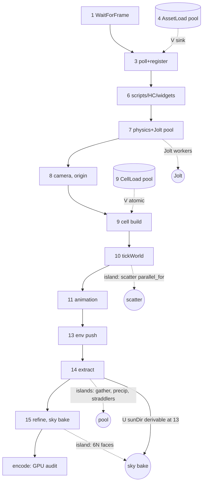

# CPU work per frame: data dependencies and job-graph fit (Thema 238, Schritt 4)

24.10.2026. **Code read only: no build, no measurement, no engine change.** Both frame orders are covered: the game (`GameApplication::OnRender`) and the editor's play mode (`EditorApplication::OnRender`); where they differ the table says so. Backends: `RenderExtractor`, `FoliageExtract` and the tick are shared code; the Metal lines are examples, the other four backends repeat the same helper (step 1, item 5). Numbers are quoted from `cpu-threading-audit-2026-10-22.md` (A1) and `cpu-threading-optimization-2026-10-22.md` (A2) only. **V** = edge read in code at the cited line, **U** = unverified (reasoned, not proven).

## 1. Steps, roughly in the order the game runs them (G = game line, E = editor line)

| # | Step | Thread | Reads | Writes | Waits on (edge) | File:line |
|---|---|---|---|---|---|---|
| 1 | `WaitForFrame` (drawable) | main, blocks | GPU frame N-1 | - | GPU pacing; moved in front of input on purpose (`b3-input-latency-pipelining`) | `Application.cpp:656` |
| 2 | Timers, http/file/anti-cheat pumps, input snapshot | main | queues, SDL | script events, input snapshot | - | G `GameApplication.cpp:3052-3187` |
| 3 | Async register: `pollAsyncResults` + `WarmupMaterials` (4 ms game, 2 ms editor) | main | async sink | `ContentManager` dense vectors, path index | e1 AssetLoad jobs, polled, **no `after`** (V `ContentManager.cpp:1341`); e2 every later cm reader (V pointer death, `RenderExtractor.cpp:139`) | G `:3217`, E `:3482`; `ContentManager.cpp:169` |
| 4 | `AssetLoad` read + `splitChunks` (stale predicate, `onCancelled`) | pool | file / pak | sink | - | `ContentManager.cpp:1280`, `:1684` |
| 5 | Net `update` | main | socket | world (snapshots, inputs) | comment says "BEFORE the simulation"; G runs it **after** 3 and 7 (V `:3320` > `:3246`), E runs it first (V `:3197`) | G `:3320`, E `:3197` |
| 6 | Scripts `onUpdate`, player/entity host, HorizonCode runtime, widgets tick | main (Lua/Python/HC) | world, input | world, bodies | e3 net (V comment `:3314`); G scripts **before** physics (V `:3231`), E scripts **after** (V `:4097` > `:4052`) | G `:3231,3295,3331-3344` |
| 7 | Physics: sync-in, Jolt `Update`, write-back, then collision dispatch | main + Jolt pool (own, `:838`) | components, mesh shapes | `TransformComponent` pose, contact queue | e4 scripts' moves, by order only (V `:3231` < `:3246`); terrain collider is rebuilt inside `tickWorld` (V `SceneSystems.cpp:108-112`), so E has it before the step and G one step late | G `:3246,3258`; `PhysicsWorld.cpp:3249,3281,3318-3447` |
| 8 | Camera controller, floating origin | main | transforms | camera pose, world shift | e5 physics (V `:3263`) | G `:3270,3280`; E `:4059` |
| 9 | Cells: `CellLoad` read+parse (pool) / build slices (main, budget) | pool / main | camera, pak | registry (entities) | e6 camera (V `:3285`); parse -> build via atomic `state` (V `CellStreamer.cpp:522`) | `CellStreamer.cpp:485,563`; G `:3286` |
| 10 | `tickWorld`: Terrain, Movement, Nav, Weather, Particles, **Foliage scatter** (`parallel_for`), Rope, TerrainTess, LOD, Seams | main (+pool for scatter) | cm, terrain, camera pos | registry, renderer uploads | e7 camera pos (V `:3364`); Terrain -> Movement / scatter (V `SceneSystems.cpp:113`, `FoliageSystem.cpp:266`); TerrainTess -> LOD -> Seams (V `:147-154`) | `SceneSystems.cpp:113-154`; `FoliageSystem.cpp:311,356`; G `:3373`, E `:4036` |
| 11 | `tickAnimation` | main only (no `parallel_for` in Animation/Particle/Weather/Transform, grepped) | cm, world, scripts via `AnimatorHost` | `boneMatrices`, root-motion velocity, notifies | e8 tick (V `:3375`) | `SceneSystems.cpp:207-241`; G `:3383`, E `:4224` |
| 12 | Audio spatial, weather audio | main -> device thread | transforms | audio engine | e5, e7 (U) | G `:3290,3407` |
| 13 | Env push (`makeEnvironmentSettings` advances the day-night clock) | main | env component | renderer settings | e9 once per frame (V comment `:3576`) | G `:3587`, E `:4448` |
| 14 | `Render()` -> `RenderExtractor::extract`: propagate, camera, mesh gather, `parallel_for`, precip `parallel_for`, **foliage**, skinned, decals, ropes, lights, day-night, shadow fit | main (+pool x2, foliage straddlers) | world, cm, store | `out.*`, **`worldMatrix`**, **cm (`ensureResident` may `loadAsset`)** | e10 propagate first (V `RenderExtractor.cpp:1416`); camera -> foliage/precip (V `FoliageExtract.cpp:795`); all objects -> shadow fit (V `:1441`); animation -> bones (V `:639`) | `RenderExtractor.cpp:1378,147,453,563,1425`; `FoliageExtract.cpp:786` |
| 15 | `RefineObjectBounds`, then `UpdateSkyEnvCube` (`parallel_for`, blocks main) | main + pool | `out.objects`, GpuMesh, `sunDirection` | bounds, env cube | e11 extract (V `MetalRenderer.mm:7935,15152`) | `MetalRenderer.mm:13887,13906` |

## 2. Graph (main-thread spine, fork-join islands, async lanes)

Nothing is scheduled through `JobDesc::after`: the only users are `tests/test_jobsystem.cpp:356,743` (V, grepped `src` and `tests`). `stale` is used by the two `AssetLoad` sites (`ContentManager.cpp:1264,1667`), `priority` by `SceneParse` (`SceneJsonParse.cpp:296`) and `CellLoad` (`CellStreamer.cpp:483`). Every async lane is a leaf job joined by polling a sink or an atomic, never a DAG; every other parallel region is a `parallel_for` the main thread waits in (`JobSystem.h:341`).

## 3. What the current order already uses, and what it leaves

Used: asset read/split and cell read/parse run on the pool across the whole frame and are consumed at one safe point each (3, 9); the extract walks once per frame (`FrameScope`, `MetalRenderer.mm:16665`) and replays a standing camera (A2); scatter, straddlers, `FrustumCull`, `ExtractMeshes` and the sky bake fan out. Left: between islands the pool is idle (A1: 0.5 to 2 % per thread) and the main thread idles in step 1 (A1 section 3; the 8 to 19 ms p50 is `step4-input-audit-2026-09-27.md`, not re-measured here). No island overlaps another, and the tick, extract and encode are strictly serial on one thread.

## 4. Candidates (all unimplemented; gains are bounds from A1/A2, none measured as parallel)

| # | Reorder / decoupling | Why the edges allow it | Risk |
|---|---|---|---|
| a | **Unify the editor and game order first** (tick before physics in E, after in G; net first in E, late in G; scripts before/after physics) | The two files disagree today (rows 5-7); a graph built on one order changes the other | Not parallelism; a behaviour change for play-in-editor, needs the comment history read |
| b | **Sky bake into a second cube, started once sun/env is known (13)**, joined at first use | Input is `sunDirection` only (e11); needs the day-night result earlier (U, `applyDayNight` equivalence) | GPU may still read the old cube in flight; IBL lags a frame. Up to 40-64 ms at first bake (A1 item 5), rebake cost not measured |
| c | **Fork the extract producers** (mesh gather, foliage plan+straddlers, skinned, decals, lights) after propagate+camera, splice in today's order | They write separate `out.*` and need only camera + transforms (V) | Blocker (V): the gather calls `ensureResident` (`RenderExtractor.cpp:147`), so pre-resolve every referenced material/bounds on main first (A1 item 2); `out.objects` order is a pixel-A/B contract (A2) |
| d | **Scatter beside the rest of `tickWorld`**, joined before step 14 (or double-buffered store) | Scatter reads terrain + the terrain entity's position only (V `FoliageSystem.cpp:266,197`) and no camera | Races the registry with Movement/Nav (U, not race-checked); pays only on dirty frames (load, sculpt) |
| e | **Idle slot in step 1**: poll+register and cell JSON release before `WaitForFrame` | They read no input | Only helps when GPU-bound; register vs GPU-held assets of frame N-1 unverified (U); breaks "never during draw" comment (`:3200`) |
| f | **Animation as per-skeleton pure eval + serial drive** | Bones are per entity (V write site `PoseFinalize.cpp:523`, `AnimationEval.cpp:150`; three drivers, last wins, `SceneSystems.cpp:228`) | `AnimatorHost` sync calls scripts, notify queue and root motion are shared; animation never measured (no animated scene in A1) |
| g | **Async physics** (Update N+1 overlaps extract/encode N) | Jolt state is internal; only sync-in/write-back touch the registry (V `PhysicsWorld.cpp:3318`) | One frame of latency, scripts/camera ordering, determinism; see `physics-threading-*.md`; not recommended before f/a |

**Rejected: overlapping extraction with the next frame's tick.** The extract writes the world (`propagateTransforms` rewrites `worldMatrix`, `RenderExtractor.cpp:66,1464`) and may call `loadAsset`, and step 3 plus the cell build mutate the same registry and `ContentManager`; there is no snapshot or asset epoch to protect the pointers (lesson: asset pointer lifetime). Anything that overlaps the extract needs a frozen copy of its inputs first.

## Handoff

- **Topic / step:** Thema 238, Schritt 4 of 6. Branch `claude/cpu-threading-audit-jobsystem-auslastung-daten-vorbereitung-`, @ 207322f0 + this doc's commit (pushed: yes, see the Hive post for the sha).
- **Files touched:** this doc only.
- **Verified:** every edge marked V was read at the cited line on this branch (`git` clean at start, `207322f0`); `after` grep over `src` and `tests`; `parallel_for` grep over Animation/Particle/Weather/Transform files.
- **Not verified:** any race claim marked U (d, b's `applyDayNight` equivalence, e); animation, audio and physics cost (no measurement in A1/A2 for these scenes); D3D11/D3D12/Vulkan/OpenGL (same helper by grep only); editor lines were read, the editor was not run.
- **Decisions taken:** covered game and editor; the GPU encode side is left to the GPU audit; no numbers beyond A1/A2.
- **Decisions suggested, not taken:** do (a) before any reorder; best value per risk is (c) after A1 item 2, then (b).
- **Traps:** `GameApplication.cpp:3314` says net runs before the simulation but the code runs it after physics (`:3246`); `ensureResident` inside the extract gather means the extract is not read-only; `EditorApplication.cpp:7565,7773` (named in the brief) are headless-dump setup, the per-frame scatter is `SceneSystems.cpp:143`; the Hive was unreachable for this run, so nothing was claimed or posted on the board before the final queued calls.
- **Next steps:** 1. Step 5: measure animation, `TerrainSystem`, `CellStreamer` build and `pollAsyncResults` on a scene that has them (A1 had none animated). 2. Pre-resolved bounds table (A1 item 2), the precondition of (c). 3. Decide (a) with the human.
