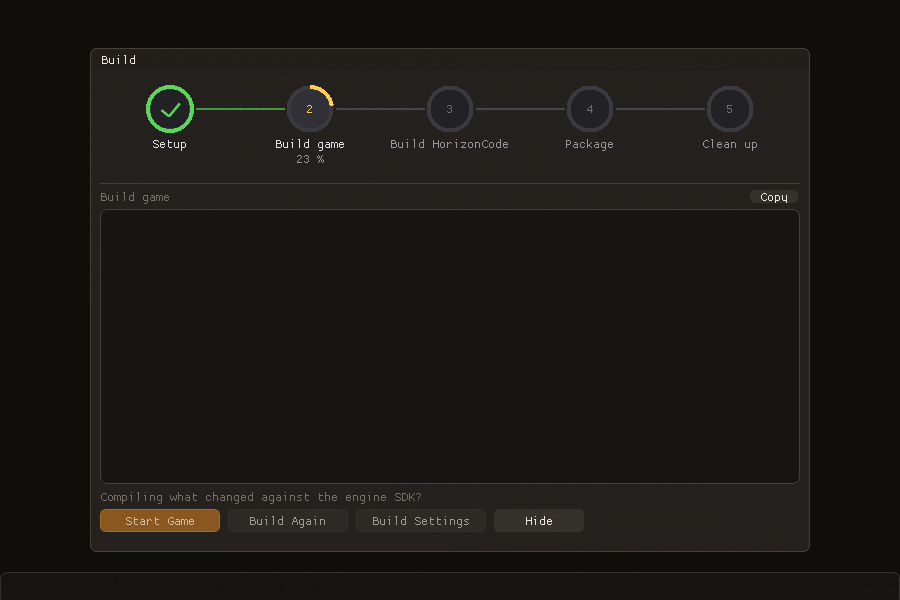

# Export progress: the game is built first (topic 222, step 6)

Before this step the Build window of an export listed `Setup, Build, Package, Clean up,
Compile game`: the game compiled from the engine SDK was the last ring, after Clean up. It
now lists, and runs, `Setup, Build game, Build HorizonCode, Package, Clean up` (Build
HorizonCode only when there is HorizonCode to compile).

## Why the display could not just be reordered

`Build::stepBegin(i)` closes every running step above `i` and leaves the ones below
pending, so the rings read top to bottom only if the worker begins them in list order. The
game compile was last for a reason: `compileGameFromSdk` built `HEGameBuildConfig.h` from
the `project.hcfg` the exporter writes at its `config` stage, and that file holds the pak
key and the startup scene's pak UUID, both drawn while packing. Moving only the label
would have put "Build game" at ring 2 while it filled after Clean up.

## What changed

* `ProjectExporter::planExport` (`src/HE_Core/src/Hpak/ProjectExporter.cpp`, end) runs the
  exporter's first two phases on their own (layout, `resolvePackSettings`: the incremental
  key reuse from the previous hcfg, executable or SDK header), picks the scene UUID and
  returns the `ProjectConfig` the export will write, key always in `encKey`. It pins key
  and UUID into `ExportSettings::planned*`; `exportProject` then packs with exactly those
  (`resolvePackSettings` and `addSceneEntries` honour them). `makeProjectConfig` is the
  hcfg without the key, shared by `writeProjectConfig` and the plan.
* `ExportSdk::writeBuildConfigFromPlan` (`src/HE_Editor/ExportSdkBuild.cpp`) writes the
  header from the plan plus the project's `Config/ProjectSettings.json`.
* `ExportDialogPanel.cpp`: the step list is in run order; the worker plans, compiles the game
  (`compileGameFromSdk`, fails the export before anything is packed), builds HorizonCode,
  packs, and installs the built game over the runtime's executable under Clean up
  (`installSdkGame`: swap, relink, codesign; failure removes the executable as before).
* The compiled-in `horizonCodeCompiled` is now the intent (HorizonCode is compiled after the
  game); the game only uses it for a warning when the library is missing, which is then true.
  The written hcfg still says what shipped.
* `tests/CMakeLists.txt`: `test_build_footer_ui.cpp` was never in `add_executable(he_tests)`
  and `BuildProgressDialog.cpp` was not in the `HE_IMGUI_ENABLED` list (its `render()` was
  empty in he_tests). Both fixed; the file's six older cases run for the first time and pass.

## Handoff

- **Topic / step:** 222, step 6. Branch `claude/engine-sdk-wird-nicht-mitgebaut-gepackaged-horizonsdk-target-v2`.
- **Done:** export rings in run order, Build game first; real execution order moved, not only labels.
- **Files:** `ProjectExporter.h` (`ExportPlan`, `planned*`, `planExport`), `ProjectExporter.cpp`
  (`resolvePackSettings`, `addSceneEntries`, `makeProjectConfig`, `planExport`),
  `ExportSdkBuild.*` (`writeBuildConfigFromPlan`), `ExportDialogPanel.cpp` (`compileGameFromSdk`,
  `installSdkGame`, step list ~1790, worker), `scripts/he_export_step_order_live.py`.
- **Verified (Mac):** `scripts/he_export_step_order_live.py /tmp/s6_order` → `plain=True hc=True enc=True`
  (rings started and finished in list order, export OK, "Game compiled from the SDK (dev)"); runs
  took 45 s (cache miss), 23 s, 23 s. All three exported games run 120 hidden frames, rc 0, "project
  configuration compiled in", pak mounted, packed startup scene loaded; the encrypted one logs
  "pak key from HEGameBuildConfig.h (compiled in)", the HC ones "3 compiled classes". New tests:
  `planExport: the export packs with the key and scene UUID planned before it`, `planExport without
  encryption…`, `writeBuildConfigFromPlan…`, `Build window: an export's rings fill in list order…`
  (picture above: `HE_EXPORT_STEPS_SNAPSHOT=/tmp/s6_order/midrun-hc.json HE_UI_DUMP_DIR=…`).
- **Not verified:** Windows/Linux (CI); a visible editor (no GUI clicking); a Shipping export.
- **Decisions:** real reorder through a plan API rather than an exporter callback, because Build game
  had to come before Build HorizonCode (which runs before `exportProject`); the header written before
  the pack is harmless if the pack fails (the incremental cache is keyed on the pak key).
- **Traps:** `test_notification_popups_ui.cpp` has the same "never compiled" gap (not touched). In zsh
  `"$r:tests/..."` is a path modifier, write `"${r}:tests/..."`.
- **Next steps:** 1. Register `test_notification_popups_ui.cpp` in he_tests and see what rotted.
