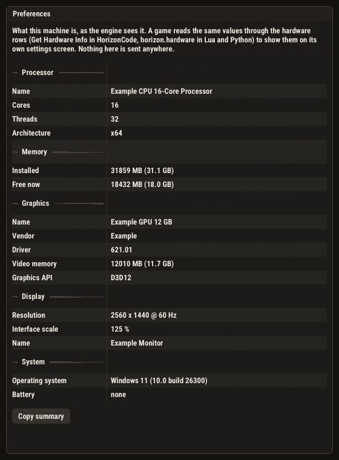
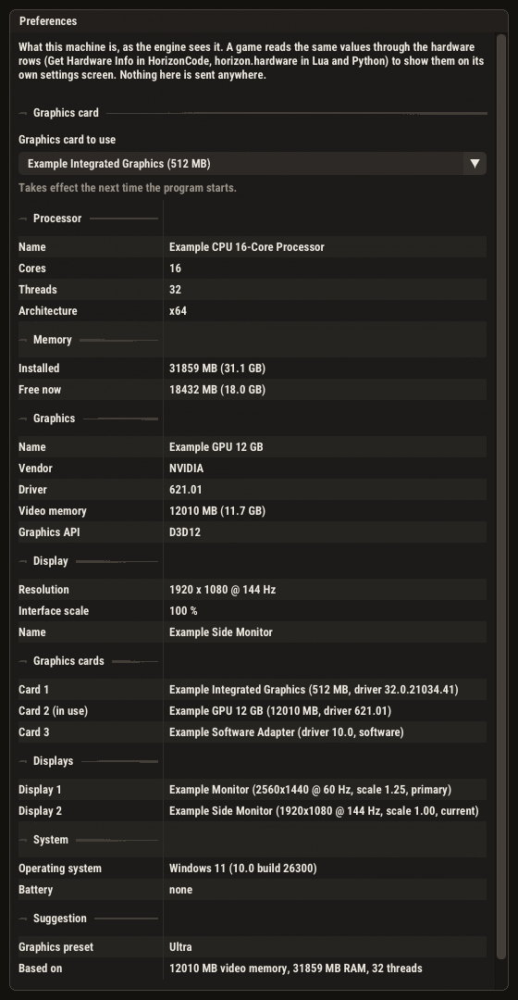

# Hardware detection: the engine knows the machine, scripts and the editor can show it

Hive topic 337 (builds on 336: the settings rows, the Quality page, the quality presets). Done 2026-11-08 on NN-WS03
(Windows 11, Ryzen 9 9950X, RTX 4070), branch `claude/hardware-erkennung-api` (cut from
`claude/quality-windows-backends`, so it carries topics 324/336 and the Windows backend work). No pull request.

## 1. What exists now

| Piece | Where |
|---|---|
| `HE::HardwareInfo` (CPU, RAM, OS, battery; GPU and display handed over later), `hardwareInfo()`, `freeMemoryMB()`, `onBattery()`, `hardwareSummary()`, the `HardwareProvider` test seam, `HardwareProperty` | `HE_Core/include/Diagnostics/HardwareInfo.h`, `src/Diagnostics/HardwareInfo.cpp` |
| The CPU / RAM / OS probes (moved out of `Log.cpp`; the startup banner and `Log::systemInfoBlock` read the same struct) | same |
| `IRenderer::GetAdapterInfo()`, filled by every backend's `Initialize` | `IRenderer.h`; D3D11/D3D12 through `D3D_Shared/DxgiAdapterLog.h`, Vulkan `pickPhysicalDevice`, OpenGL's GPU block, Metal, Software |
| Hand-over of GPU and display, five `Hardware` lines in the log (plus one `Other GPU` / `Other display` line per extra adapter / monitor) | `Application.cpp`, after the renderer is up |
| 26 `hardware.*` registry rows (+ 16 for several GPUs / displays and the GPU choice, section 7) (HorizonCode, Lua, Python, C++) and the built-in enum `engine:HardwareProperty` | `HE_Scene/src/EngineApi.cpp`, `TypeRegistry.cpp`, node docs in `HcNodeDocs.cpp` |
| The editor page Preferences » Preview » Hardware | `HE_Editor/HardwarePage.{h,cpp}`, `EditorSettingsPanel.cpp` |
| Suggested preset: `recommendQualityPreset` + reason, rows `hardware.recommendedPreset` / `...Reason`, a hint on the Quality page | `QualitySettings.h`, `ProjectSettings.cpp` |
| Manual section "Hardware Info" (rendering page, after Quality Settings) | `EditorDeps/Docs/he-docs.json` |

Only type and model names and sizes: no serials, device ids, MAC addresses or user names, and nothing is sent anywhere.

## 2. The values

| Group | Fields | Where they come from |
|---|---|---|
| Processor | name, physical cores, logical threads, architecture | Windows: `cpuid` brand string, `GetLogicalProcessorInformationEx`, `hardware_concurrency`. macOS: `sysctl machdep.cpu.brand_string`, `hw.physicalcpu`. Linux: `/proc/cpuinfo` (cores = distinct physical id / core id pairs, 0 when the board lists none) |
| Memory | installed MB, free MB (fresh on every read) | `GlobalMemoryStatusEx` / `sysctl hw.memsize` + `host_statistics64` / `sysconf` + `/proc/meminfo` |
| Graphics card | name, vendor, driver, video memory, API | the running renderer (below) |
| Display | width, height, refresh, scale, name | SDL: the display the window is on, read right after the renderer is up |
| System | OS name, OS version line, battery present, on battery | Windows `RtlGetVersion`, `GetSystemPowerStatus`; macOS `uname` + `kern.osproductversion`, `hw.model` containing "Book"; Linux `/etc/os-release`, `/sys/class/power_supply` |

Graphics card per backend: D3D11 / D3D12 ask DXGI (name, vendor id, dedicated memory, driver; NVIDIA's own number is built
from the Windows driver version: `32.0.16.2101` becomes `621.01`); Vulkan reads `VkPhysicalDeviceProperties` and the
device-local heap (NVIDIA's packed driver version is decoded, Intel's on Windows too); OpenGL reads `GL_RENDERER` (cut before the
first slash) and `GL_VERSION` (the part after the vendor), video memory only through `GL_NVX_gpu_memory_info`, otherwise 0; Metal takes the
device name and its recommended working set (shared memory); the software renderer says "CPU rasterizer". A field a platform cannot
answer stays empty / 0; the editor page shows a dash and the rows return `""` / `0`, never a guess.

## 3. Checked on this machine

The five log lines of each backend against Windows' own tools (`Get-CimInstance`):

| | engine | Windows |
|---|---|---|
| CPU | AMD Ryzen 9 9950X 16-Core Processor, 16 cores, 32 threads | same (Win32_Processor) |
| RAM | 31859 MB | 31860 MB (rounding) |
| GPU / driver | NVIDIA GeForce RTX 4070, 621.01 (`32.0.16.2101`) | same name; DriverVersion 32.0.16.2101 |
| Display | 2560x1440 @ 60 Hz, scale 1.25 | 2560x1440, 59 Hz (59.94 shown as 59), scale 125 % |
| OS | Windows 11 (10.0 build 26300) | Windows 11 Pro, build 26300 |

The GPU line on the four backends: `NVIDIA GeForce RTX 4070 (12010 MB, driver 621.01, D3D11 / D3D12 / Vulkan)` and
`(12282 MB, driver 621.01, OpenGL)`. The video memory differs by source: DXGI and Vulkan report 12010 MB, the NVIDIA GL extension
12282 MB; neither is "wrong", they count differently.

Tests (`he_tests`, this tree): `test_hardware_info` 13 cases (module, provider seam, merge, summary, vendor names, the 26 rows
over a fake machine and over the real one, by name / by enum, the built-in enum, the preset thresholds, reason line),
`test_horizoncode_codegen` (new parity fixture `hardware_rows`: the interpreted and the compiled half read the same machine),
`test_scripting_binding` (Lua about box), `test_python_scripting` (Python about box), `test_ui_shot` (the Hardware page, picture below),
`test_docs_library` (the manual section), `test_engine_api*`, `test_hc_node_docs`, `test_logging` (the startup block unchanged).
`editor_help_audit.py --check`: 1277 / 1277. The whole `he_tests` suite ran green at the step-5 state (6220 / 6220 cases, 2 155 532
assertions, 20 skipped); afterwards only the manual section, its test and the real-machine row test were added, and those files re-ran
green (`test_docs_library` 17 / 17, `test_hardware_info` 13 / 13, `test_ui_shot` 51 / 51, `test_editor_help` 19 / 19). `HorizonEditor` builds.

(A made-up machine through the provider seam, so the picture does not depend on the PC it was made on.)

## 4. The suggested preset

`recommendQualityPreset` is a coarse guess, shown as a suggestion and never applied: video memory sets the ceiling (10000 MB and
up Ultra, 6000 High, 3000 Medium, below Low; unknown memory at most Medium; Apple GPUs by RAM: 32 GB Ultra, 16 GB High), RAM and
threads cap it (Ultra 16 GB + 8 threads, High 12 GB + 6, Medium 8 GB + 4), no usable GPU or the software rasterizer reads Low. On this
PC (12010 MB, 31859 MB, 32 threads): Ultra. It is the lower of the two answers. A measured recommendation (timing the presets) is
the follow-up topic and would replace it; the timings in `docs/quality-windows-backends-2026-11-08.md` show what such a benchmark
would see (for example D3D11 High is dominated by software GI).

## 5. Not done / not verified

* macOS, Linux and the Metal adapter code are written but were not built or run (this is a Windows machine): the `sysctl` /
  `/proc` / `MTLDevice` paths, macOS battery (`onBattery` is always false there: no IOKit link), `host_statistics64` free memory.
  The Mac in the Hive can verify them; the unit tests there will run the same fake-provider cases.
* The Website manual (`rendering.html`) and the generated scripting-reference page were not touched (separate repo / generated); the
  in-engine manual has the section.
* A "game settings menu" example as a ready-made graph: the Lua and Python samples in the manual and their tests are the working
  examples.
* A visible-window run of the editor with the new page open was not done; the page is checked headless (UI test, picture) and its
  data on the real machine through the log lines of all four backends.

## 6. Several GPUs, several displays, a GPU choice (steps 7-11)

Asked for after the first version: "with several GPUs and changing displays it should show correctly, and one should be able to
choose which GPU is used, honored at start, otherwise fall back to the default GPU."

**Lists.** `HardwareInfo::gpus` holds every adapter with a stable id `vvvv:dddd:n` (PCI vendor : device : number among identical
cards, lower-case hex, the same on D3D11, D3D12, Vulkan and across restarts), the one the renderer runs on marked `active`. Windows
lists them through DXGI before any renderer exists; Vulkan and Metal report their own list where the platform has none (Linux).
OpenGL cannot read ids, so its active card is matched by name. `HardwareInfo::displays` holds every connected display (name,
size, refresh, scale, position, primary), the one the window is on marked `current`; the application republishes it on
`SDL_EVENT_DISPLAY_ADDED / REMOVED / MOVED / CURRENT_MODE_CHANGED / DESKTOP_MODE_CHANGED / CONTENT_SCALE_CHANGED` and
`SDL_EVENT_WINDOW_DISPLAY_CHANGED / DISPLAY_SCALE_CHANGED`. The current display is the one the window overlaps most
(`displayForRect`, nearest one when the window is off every display). The summary and the log get `Other GPU:` / `Other display:`
lines.

**Choice.** `GpuAdapter` (config.json custom key, editor) or `gpu_adapter.txt` in the game's per-user folder (a shipped game cannot
write config.json; the export may carry a default `GpuAdapter`); `HE_GPU_ADAPTER` overrides both (`default` = none). It is read in
`Application::Run` *before* the renderer exists. D3D11 / D3D12 create the device on the matching DXGI adapter, Vulkan takes the
matching physical device if it can draw to the window, Metal the matching `MTLDevice` (written, not built here), OpenGL cannot
pick and says so. An id that is not in the machine, or a device that fails to be created, falls back to the default adapter with one
warning (`noteSelection` / the Vulkan, Metal and OpenGL equivalents); `HE::gpuSelection()` records what came of it.
A change applies at the next start (the running device never moves).

**Script rows** (all four languages): `gpuCount, gpuNames, gpuIds, gpuAt(i), activeGpuId, preferredGpu, setPreferredGpu(id),
gpuChoiceNote, displayCount, displayNames, displayAt(i), currentDisplayIndex` (`setPreferredGpu` refuses an id that is not listed).
**Editor:** Preferences » Preview » Hardware has the drop-down "Graphics card to use" (Default + every adapter, the saved one
selected, a vanished card shown as "... (not present)", greyed with the reason on OpenGL, "takes effect at the next start"), and
the groups "Graphics cards" and "Displays" when there is more than one:

(A made-up machine through the provider seam.)

### Checked on this PC (RTX 4070 + AMD Radeon iGPU + Windows' Basic Render Driver, one monitor)

* Log on D3D11 / D3D12 / OpenGL / Vulkan: `GPU: NVIDIA GeForce RTX 4070 (...)` plus `Other GPU: AMD Radeon(TM) Graphics (485 MB, driver 32.0.21034.41)` and
  `Other GPU: Microsoft Basic Render Driver (..., software)`.
* `HE_GPU_ADAPTER=1002:13c0:0` (the iGPU) really moves the work: D3D11 / D3D12 / Vulkan log `running on the chosen adapter` and
  `GPU: AMD Radeon(TM) Graphics`, the GPU timer follows, and the frame is **pixel-identical** to the RTX frame (0 pixels differ by more than 8/255, all three APIs):

  | API | RTX 4070, median GPU ms (2 runs) | AMD iGPU, median GPU ms (2 runs) |
  |---|---|---|
  | D3D11 | 0.088 / 0.084 | 2.556 / 2.555 |
  | D3D12 | 0.100 / 0.095 | 2.966 / 2.969 |
  | Vulkan | 0.101 / 0.102 | 3.687 / 3.655 |

  (Same small scene, `HE_DUMP_GPUTIME=150`; absolute numbers say little, the point is that the other adapter is the one rendering. The D3D11 timer plateaus, see the quality document.)
* An unknown id (`dead:beef:0`) on D3D11 / D3D12 / Vulkan: one warning, the RTX runs. OpenGL with a choice: one warning, "OpenGL cannot choose the graphics card", the RTX runs.
* The editor with `GpuAdapter` in its config.json starts on the iGPU (D3D12).
* A **real exported game** (exported with the new editor, `HEProject.exe`, game compiled from the SDK): with `gpu_adapter.txt` = the iGPU the game starts on
  `AMD Radeon(TM) Graphics` on D3D11, D3D12 and Vulkan; with an unknown id or on OpenGL it warns and runs on the RTX; without a file it runs on the RTX as before.
* Tests: `test_hardware_info` 25 cases (the list and active marking by ids / id / name, twin cards, renderer-list fallback, active card never missing, summary lines, choice
  file round trip and the environment override, the rows, `displayForRect` on three monitors with negative coordinates, the list following the window, a monitor unplugged,
  the rows and lines for displays), `test_ui_shot` (the page with two cards and two displays, the choice states: default, chosen, applied, vanished, OpenGL),
  `editor_help_audit.py --check` 1277 / 1277, the engine-API, node-doc, codegen, Lua and Python tests re-run green.

### Not verified (and why)

* **Several real monitors**: this PC has one (BenQ GW2765). The display list, the current-display logic and the rows are covered by the unit tests with three made-up monitors
  (negative coordinates, straddling, unplugged); the SDL events and a live drag to another monitor were not exercised.
* **macOS / Linux / Metal**: the Vulkan list on Linux and the Metal device list and choice are written and read carefully but were not built or run (Windows machine). On macOS the ids use the vendor id as a stand-in (Metal exposes no PCI ids) and `0` as the device id.
* **Hybrid laptops (Optimus / switchable graphics)**: an explicit D3D11 / D3D12 / Vulkan device on the chosen adapter works, but whether a window shown on the other GPU's output has to copy through the integrated card is the driver's business and was not measured.
* A **GPU hot-plug** (eGPU) while the program runs: the list is detected once; the choice is made at start anyway.

## 7. Files

`Diagnostics/HardwareInfo.{h,cpp}`, `Log.cpp`, `IRenderer.h`, `DxgiAdapterLog.h` (also `chooseAdapter` / `noteSelection`), the five renderers' `Initialize`, `Application.cpp`, `GameApplication.cpp` (choice folder),
`TypeRegistry.{h,cpp}`, `EngineApi.{h,cpp}`, `HcNodeDocs.cpp`, `QualitySettings.h`, `ProjectSettings.cpp`, `HardwarePage.{h,cpp}`,
`EditorSettingsPanel.{h,cpp}`, `ProjectSettingsPanel.cpp`, `EditorHelp.cpp`, `EditorDeps/Docs/he-docs.json`, tests and the
codegen fixture (`tests/CMakeLists.txt` lists the generated class `HardwareRows`).
