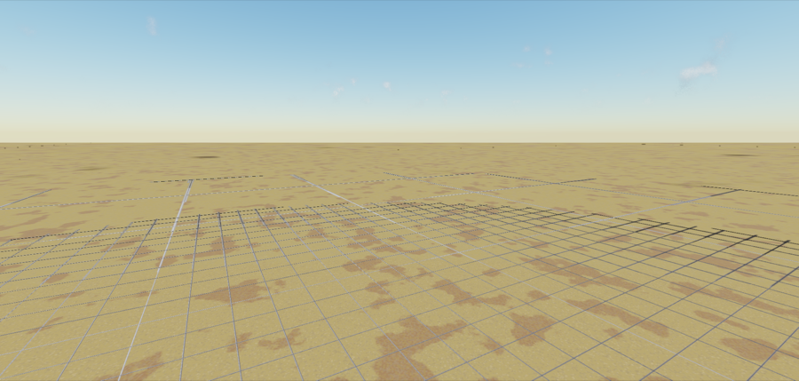
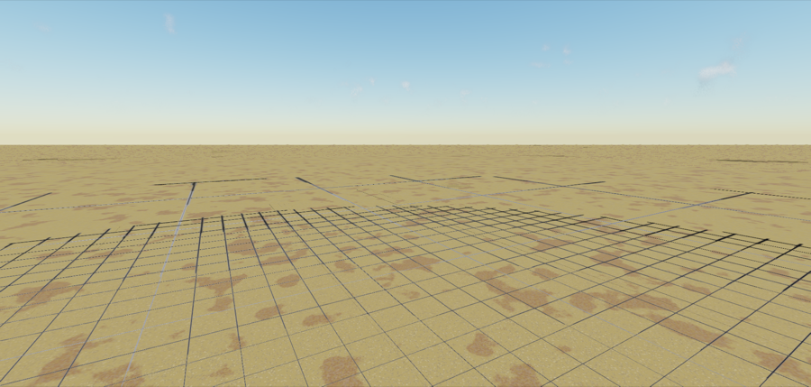
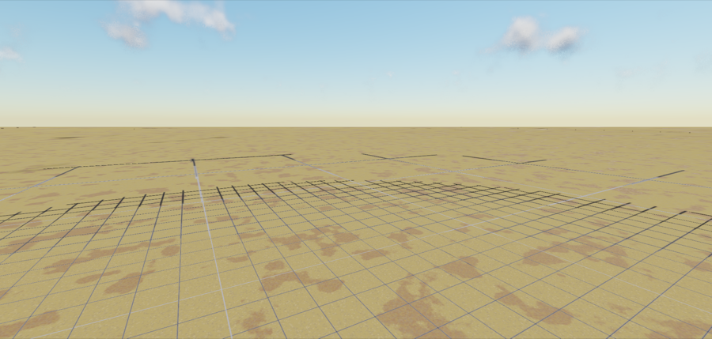
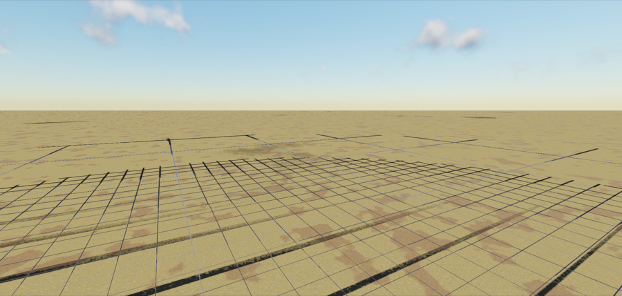
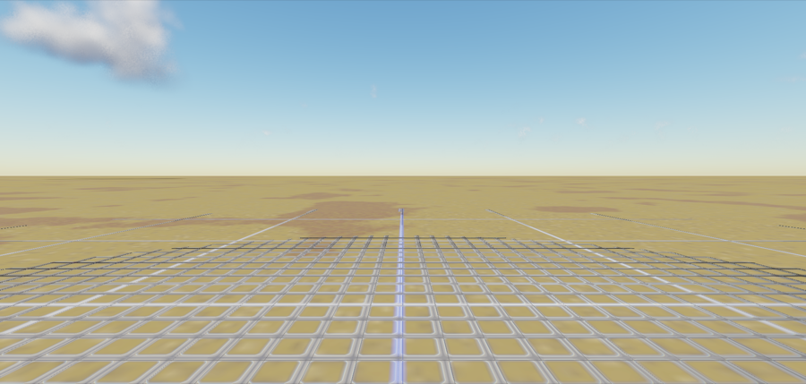
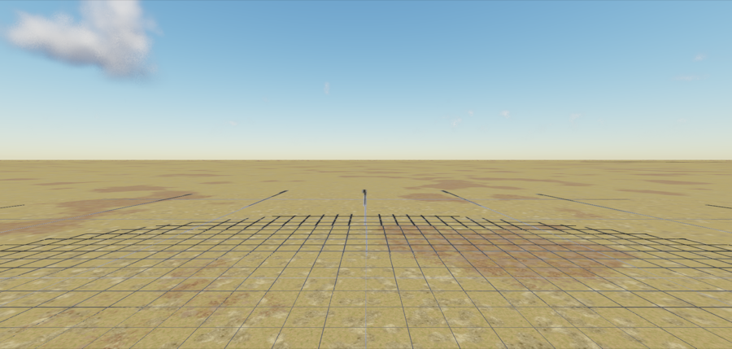
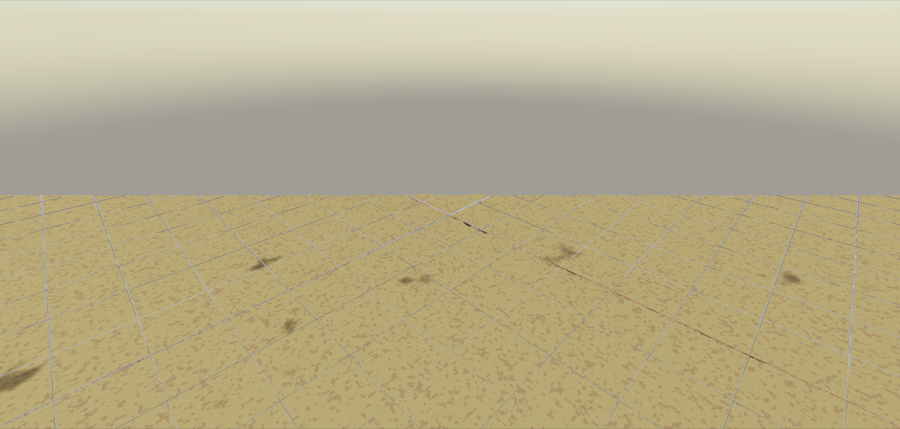
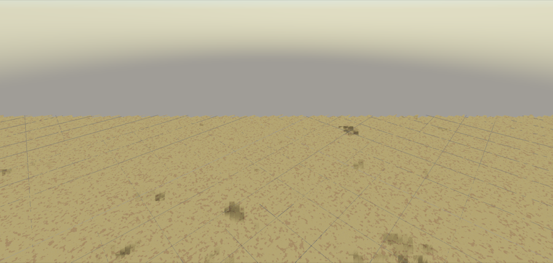
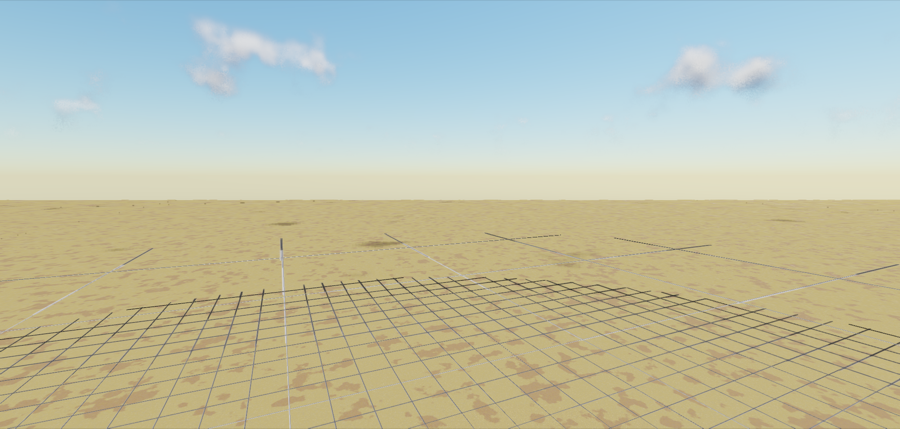
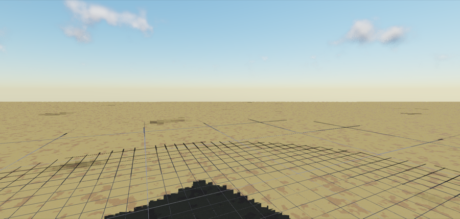

# Landscape one system: Catania baseline, old TerrainComponent path vs the same scene migrated to tiles (2026-11-26)

Topic 355, step 2. No engine code changed. This is the yardstick for the removal of `TerrainComponent` at the end of the topic.

**Conditions (all runs):** Apple M5 MacBook, **mains power** (`pmset -g batt`: "Now drawing from 'AC Power', 80%; AC attached; not charging" before every run, logged in `raw/` driver output),
low power mode off, Metal, deferred path, the editor of this tree (`out/deploy/Editor/HorizonEditor`, built 21:54 from `ea2f21e29`), hidden window
(`HE_HIDDEN_WINDOW=1`), vsync off, 3200x1800 back buffer, load average 1.4-2.6 (other Hive bees were running, see "Caveats"). The screen was **locked**
(`CGSSessionScreenIsLocked=Yes`); a hidden window is not composed, so this did not matter here, but it is recorded.

## What is compared

| | (a) old | (b) tiles |
|---|---|---|
| Project | copy of `~/HorizonEngineProjects/Catania` | the same copy plus the migration |
| Scene | `Content/StartupScene.hescene` (4 entities, `Terrain` 100 km x 100 km, 1025 height samples, 512 weight res, material asset 1042) | `Content/StartupScene.hescene` of the migrated copy: the `TerrainComponent` removed, one entity `Tile Landscape` with `LandscapeWorldComponent` -> `Content/Catania.hlp` (196 x 196 tiles of 512 m, 38 416 tiles, 16.3 MB, built in 5.6 s) |
| Landscape path | `TerrainSystem` chunk meshes + Auto Landscape material + `RvtLandscape` | `LandscapeRuntime` + `kLandscapeFS` fixed layer blend (`textureGroup` 0) |

**It is not a like-for-like landscape comparison.** The two columns also differ in: the material (graph material 1042 + RVT vs the fixed tile shader),
GI (the old column runs GI shadow/accel/probe/reflection passes, the tile column has none of them in the detailed capture: the tile world has no GI on Metal, see the plan),
and the tile column's first-frame streaming. Do not attribute the whole difference to the landscape pass.

**Catania is flat.** The migration reports heights `0.0 m + 1.0 m`: the `sculptHeightsB64` of the scene is all zero (the `heightScale: 20` octaves are not part of the stored field).
So the five views differ only in distance, angle and what the far tiers have to do; there are no hills. A hilly baseline is a separate need.

**Migration gotchas found on the way (reported, not fixed):**
1. `migrateTerrainToPack` puts the terrain's south-west corner at pack (0, 0): the world moves from [-50 km, +50 km] to [0, +100 km]. The new entity is at the origin, so the old
   origin is now at the *corner* of the tile world (first picture I took showed exactly that). The tile column's cameras are therefore the old ones **+50 000 m in x and z**.
2. The button only writes the pack and fills `LandscapeWorldComponent` of an *existing* entity; it does not delete the old `TerrainComponent`. My tool (`tools/migrate.cpp`) does what a user does next: new entity with the component, `TerrainComponent` removed.
3. The editor camera comes from `<project>/Saved/EditorView.json`, **not** from `config.json` (`EditorApplication::loadProjectCameraView`, commit e0cef661f). `he_perf_capture.py --cam` therefore does nothing any more; the driver writes the EditorView.json before each run.
   (My first four runs used the default framing for that reason and were discarded.)

## Results

Medians over 600 frames after 300 warmup frames. Every row ran twice (r1 / r2); the spread is in the last column of the raw table (`raw/table.md`).
"frame time" = the profiler's `deltaMs` p50; it is **pinned at 8.2-8.4 ms (120 Hz) in every run**, so it is a cap of the hidden window, not a cost. The GPU number is the one that moves.

| view | column | fps avg (r1/r2) | frame time p50 | GPU whole-frame p50 ms (r1/r2) | Scene pass p50 ms (counters run) | CPU `Landscape` / `RvtLandscape` p50 ms | RSS max MB (r1/r2) | hitches (r1/r2) |
|---|---|---|---|---|---|---|---|---|
| 1 | old | 120.0/120.0 | 8.17 | **7.35/7.32** | 6.28 | 0.000 / 0.836 | 1626/1602 | 0/0 |
| 1 | tiles | 119.9/119.9 | 8.25 | **16.81/16.74** | 12.80 | 0.148 / 0.095 | 2093/2101 | 0/0 |
| 2 | old | 120.0/120.0 | 8.15 | **7.07/7.06** | 6.03 | n/a (see raw) | 1691/1671 | 0/0 |
| 2 | tiles | 117.7/117.2 | 8.07 | **17.15/17.17** | 13.21 | 0.018 / - | 2094/2097 | 6/7 |
| 3 | old | 120.0/120.0 | 8.30 | **7.17/7.17** | 6.13 | 0.002 / - | 1206/1206 | 0/0 |
| 3 | tiles | 119.8/119.9 | 8.35 | **6.77/6.51** | 4.19 | 0.178 / - | 2066/2071 | 0/0 |
| 4 | old | 120.0/120.0 | 8.25 | **6.94/6.75** | 5.75 | 0.000 / - | 1649/1626 | 0/0 |
| 4 | tiles | 83.4/83.4 | 8.43 | **13.01/13.01** | 10.60 | 0.019 / - | 2158/2161 | 64/64 |
| 5 | old | 120.0/120.0 | 8.16 | **7.16/7.15** | 6.15 | 0.000 / - | 1684/1642 | 0/0 |
| 5 | tiles | 90.6/90.6 | 8.28 | **13.71/13.72** | 9.13 | 0.034 / - | 2151/2151 | 64/64 |

(Dashes: I only read the RvtLandscape scope on view 1; the full per-run CPU-scope lists are in `raw/*-gpu.summary.json` under `cpuScopePerFrame`. Power state for every row: mains.)

| measure | old, view 1 | tiles, view 1 | how obtained |
|---|---|---|---|
| Landscape GPU pass | **not measured as a pass of its own**; the detailed capture's `GBuffer` pass (everything the deferred scene draws, here the landscape + sky/clouds + grid) p50 **2.77 ms** (view 4, `old-v4-det`; GI passes extra: GIShadow 0.50, Reflections 1.47) | `GBuffer` p50 **10.8 ms** (view 4, `tiles-v4-det`; detailed-mode whole-frame GPU p50 there 11.59 ms vs old 5.36 ms) | `--detailed` capture, `gpuPassPercentiles`. Metal has no separate landscape pass: both paths draw into the G-buffer pass. Detailed numbers are per-encoder and not comparable to the whole-frame column (mode differs). |
| RSS | 1626 MB max | 2093 MB max | `ps -o rss=` once a second by `he_perf_capture.py`, max of the samples (first column of the table above) |
| Device (GPU) memory | **not measured** | **not measured** | the profiler's `vramUsedMB` / `vramBudgetMB` are 0 on Metal (`counters_midframe`). No Metal allocation counter is read by the harness; I did not add one (no code changes). |
| draws / tris (counters, view 1) | 10 draws, 60 928 tris | 1 draw, 0 tris reported | `counters_midframe` |

Read of the numbers (what they say, not why): on views 1, 2, 4, 5 the tile column's GPU frame is 1.8-2.4 times the old one; on view 3 (10 m above the ground, near the world's centre) it is equal or slightly lower.
The tile column is 470-860 MB larger in RSS on every view (view 3: 2066 vs 1206 MB) (and the tile column also ran with 64 hitches per 600 frames on views 4 and 5, 6-7 on view 2, none on the old path).
I did not investigate why (no fixes in this step).

### Repeat check

Every point ran twice, the old and the tile column each. Frame-time p50 (`deltaMs`) differs between r1 and r2 by < 0.05 ms; GPU p50 by 0.00-0.20 ms (largest: tiles view 3, 6.77 vs 6.51 ms; old column <= 0.19 ms).
The differences between the columns (up to 10 ms) are far outside that. The scope check: `python3 scripts/perf/dump_scope_p50.py <dump> Landscape Terrain RvtLandscape` lists
`Landscape`, `Terrain` and `RvtLandscape` in both columns (old view 1: RvtLandscape 0.836 ms p50, Landscape 0.000; tiles view 1: Landscape 0.148, RvtLandscape 0.095).

## Pictures

The same editor camera in both columns (tile column shifted +50 km, see above), frame 250 of the run, 2002 x 954 viewport, downscaled to 900 px. The editor ground grid is drawn in both. Files: `landscape-one-system-baseline-2026-11-26/`.

| view | camera `x, y, z, yaw, pitch` (old coordinates) | old | tiles |
|---|---|---|---|
| 1 | 7795.838, 113.462, -4011.834, 69.634, -0.167 (the owner's own Catania camera) |  |  |
| 2 | same position, yaw 71.205 (+pi/2) |  |  |
| 3 | 0, 10, 0, 0, -0.05 (low, at the old terrain's centre) |  |  |
| 4 | 2811.128, 2113.346, 2811.128, -0.785, -0.488 (the editor's default frame of the whole old terrain) |  |  |
| 5 | 20000, 300, 20000, 2.0, -0.1 (28 km out) |  |  |

I opened all ten: none is black or unlit; both columns show the same camera (same horizon, same grid position, same cloud field).
**Defect in the tile column, view 5:** a dark grey, unlit stair-stepped area at the bottom of the picture (tiles not drawn / drawn without light). It is still there at frame 800
(`tiles-v5-late.png`), so it is not a loading transient. Reported, not investigated. The surfaces also differ in look (old: orange spots on sand; tiles: rocky sand texture)
because the materials differ.

## How to reproduce each number

Paths: `W=/tmp/he_base_catania` (gone after a reboot; recreate as below). The editor is `out/deploy/Editor/HorizonEditor` of this tree.

1. **Private config** (the user's, copied; the real HOME is only read):
   `mkdir -p $W/cfg; cp ~/Library/Application\ Support/HorizonEngine/{config.json,imgui.ini,material-pipelines.metalar} $W/cfg/; cp -c -R ~/Library/Application\ Support/HorizonEngine/{EngineContentCache,EngineContentCookCache} $W/cfg/`
   (`cp -c` = APFS clone, so the 8 GB cache is not copied and the original is not touched). `he_perf_capture.py` rewrites `config.json` (project, `RHI`, the `--set` keys); `tools/run_matrix.py` passes the user's render keys (AA, GI, SSAO, SSR, RenderScale, RuntimeVirtualTextures ...) as `--set`.
2. **Project copy without team binding:** `rsync -a --exclude .git --exclude Saved/TeamSync ~/HorizonEngineProjects/Catania/ $W/old/`, then in `$W/old/Config/ProjectSettings.json` replace `"sourceControl"` by `{"mode": "none"}` (an unknown mode is read as plain git; the copy has no `.git`). The runs also set `HE_COLLAB_OFFLINE=1`.
3. **Column (b):** `rsync -a $W/old/ $W/tiles/`, build `tools/migrate.cpp` against `cmake-build-release/src/HE_{Scene,Core,Net}` (flags from `cmake-build-release/src/HE_Scene/CMakeFiles/HorizonScene.dir/flags.make`, link `-lHorizonScene -lHorizonCore -lHorizonNet`), run
   `migrate $W/old/Content/StartupScene.hescene $W/tiles/Content/StartupScene.hescene $W/tiles/Content/Catania.hlp`. It calls `HE::migrateTerrainToPack` with the same arguments as `LandscapeWorldTools::startMigrate` (default geometry, `yOffsetM` = the terrain entity's world y). The real editor button was **not** clicked (no headless path to it); the tool replaces the click, and the scene edit afterwards is what a user does by hand.
4. **Frame time, GPU whole-frame, RSS** (`--no-counters`): `python3 tools/run_matrix.py <old|tiles> 1,2,3,4,5 fps [-r2]`
   = per view `python3 scripts/he_perf_capture.py --project $W/<col>/HEProject.heproj --label <col>-v<N>-fps --out $W/raw --cfgdir $W/cfg --warmup 300 --frames 600 --no-counters --env HE_HIDDEN_WINDOW=1 --env HE_COLLAB_OFFLINE=1 --env HE_BACKGROUND_FPS=0 --env HE_CAPTURE_FRAME=250 --env HE_CAPTURE_PATH=<ppm> --set ...`. The driver writes `<col>/Saved/EditorView.json` (the camera) first. Numbers: `fps.avg`, `deltaMs.p50`, `gpuMs.p50`, `rssMB.max` in the `*.summary.json` (copies in `raw/`).
5. **Scene pass / CPU scopes:** same with mode `gpu` (counters on). Scope check: `python3 scripts/perf/dump_scope_p50.py $W/raw/<col>-v1-gpu.profile.json Landscape Terrain RvtLandscape` (the `.profile.json` dumps are 7 MB each and not committed).
6. **GBuffer pass:** mode `det` (`--detailed`), `gpuPassPercentiles.GBuffer.p50`.
7. **Pictures:** `HE_CAPTURE_FRAME=250` / `HE_CAPTURE_PATH` in the same runs (PPM of the viewport), `sips -s format png -Z 900`.
8. **Power:** `pmset -g batt` before every run (the driver prints it with the time and load average).

## Caveats

* CPU load of other Hive bees (load 1.4-2.6, not zero) was present; GPU numbers repeat to 0.2 ms, CPU numbers are not the point here (capped at 120 Hz).
* Hidden-window frame rate is a 120 Hz cap; the on-screen frame time at the unlocked, visible display (60 Hz vsync) is **not measured**.
* Device memory not measured (see table). RSS includes the 8 GB-clone-backed cache mappings only as far as they are touched.
* One scene, a flat one. The step asked for Catania; nothing about hills, foliage, water or scatter is in this baseline (the scene has none).
* The fps column of the tile rows with hitches (views 2, 4, 5) is below the cap because of those hitches, not because the frame time grew.

## Handoff

* **Done:** this document; scripts and the migrate tool in `landscape-one-system-baseline-2026-11-26/tools/`, per-run summaries in `.../raw/`, ten pictures. Verified: every number above came out of the summaries in `raw/` (re-run once, spread stated); pictures opened and compared.
* **Not verified / not measured:** device memory; visible-window on-screen frame time; the real editor button (replaced by `tools/migrate.cpp`); the cause of the 2x GPU, +470 MB RSS and the hitches on the tile side; the black area in `tiles-v5`.
* **Decisions:** tile cameras = old + 50 km; `TerrainComponent` removed in column (b); views 1-5 as listed; `HE_BACKGROUND_FPS=0`; kept the user's render settings via `--set`.
* **Next:** (1) decide whether the migration should centre the world (origin shift) before the removal step; (2) the black tiles at tiles-v5 and the 64 hitches on views 4/5 are candidates for the landscape-material / RVT steps; (3) a hilly Catania (or a generated one) is needed before the RVT tier steps can be judged against terrain; (4) delete `/tmp/he_base_catania` when no longer needed (9 GB, clone-backed).
