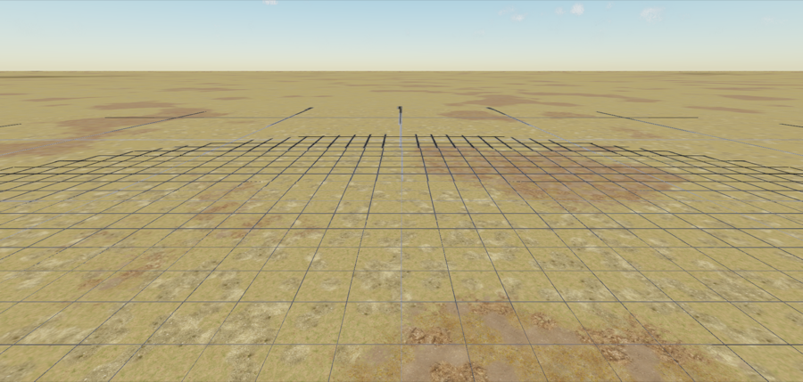
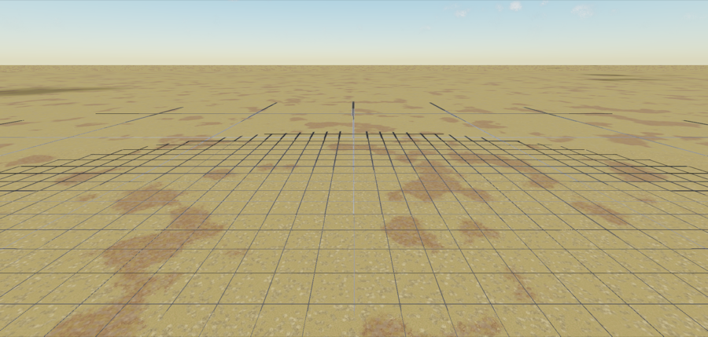
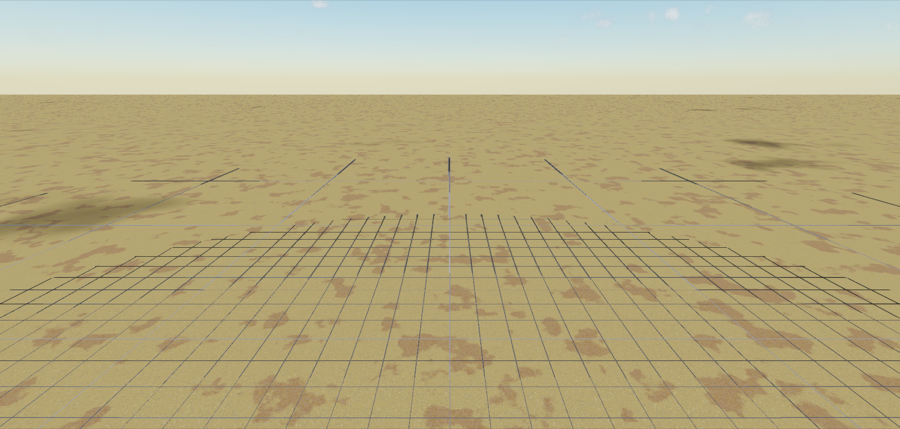
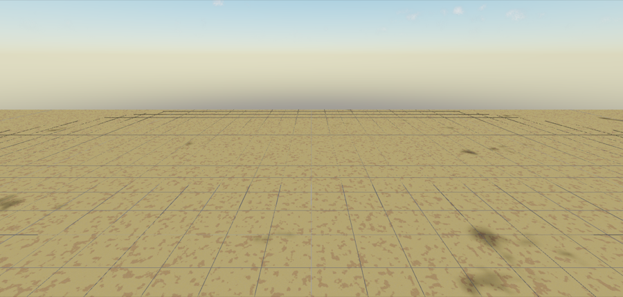

# Landscape one system: RVT on the 100 km tile world, 1.6 cm preset (2026-11-27)

Topic 355, step 4. **Question:** is the RVT ground of a 100 km tile world sharp near the camera, coarser in the mid range, and bounded in memory?
**Answer: yes for the 4 km window around the camera, on Metal, at the 1.6 cm preset. No engine code was changed** (the step said to add camera-centred fine levels only if the near ground is not sharp).
What RVT does **not** cover is the ground more than about 2 km from the camera: it is drawn in place with the full material, there is no coarser far tier yet (see "Not verified" and the handoff's Pending).
Two things the measurement found that the step did not ask about are in "Findings outside the step".

**Conditions (all runs):** Apple M5 MacBook, mains power (`pmset`: AC attached), Metal, deferred path, hidden window (`HE_HIDDEN_WINDOW=1`), 3200 x 1800 back buffer,
viewport 2002 x 954, vertical fov 60 degrees, the editor of this tree at `878772186` **plus a temporary probe** (`landscape-one-system-rvt-tiers-2026-11-27/tools/rvt-tile-probe.patch`, not committed),
load average 2-3 (other Hive bees). Project: `/tmp/he_s4/tiles`, a copy of the step-2 migrated Catania (`Catania.hlp`, 196 x 196 tiles of 512 m = 100.35 km, a flat world: heights 0-1 m).
The project's `ProjectSettings.json` and `StartupScene.hescene` were diffed against the owner's Catania and against step 3's saved originals: the only difference is `sourceControl: none` (the baseline recipe's). Project RVT settings (the owner's Catania ones): pool 1024 pages, texel 0.015625 m (**1.6 cm, "finest"**), near radius 64 m, native near off, tile native near off (default), 8 pages painted per frame.
Camera: `x = z = 50000` (the middle of the world), yaw 0, pitch -0.35 (2 m: -0.2), height 2 / 10 / 50 / 200 / 1000 m above the ground, 900 frames of warm-up (pool full, `missing 0`).

## What RvtLandscapeTiles does on a 100 km world (read from the code, then checked by the probe)

* `tileGroundVolumes` (`RvtLandscapeTiles.cpp:127`): a volume holds at most 2048 pages a side (the page key's limit). At 1.6 cm a page is 128 texels = **2.0 m**, so the volume is a **window of 2048 x 2.0 = 4096 m**,
  12 mips (mip 11 = the whole window in one page, 32 m texel). It is re-anchored on a grid of 1024 m when the camera leaves the middle half. The texel is **not** clamped: the window shrinks, the texel does not.
  Probe: `window 4096 m, page0 2.00 m, texel0 0.0156 m, 12 mips, anchor (48128,48128), cam in window (1872,1872)`.
* So the clamp-aware radii of `f83f209f5` (checked with `git show`: "RVT radii follow the clamped texel", `RvtLandscape.cpp:517` `nativeNearRadius(texel)`) matter for the old per-terrain path, where attach clamps a 100 km volume to 0.5 m.
  The tile path never has a clamped texel; `tileGroundViews` (`:190`) uses `nativeNearRadius()` of the setting, which **is** the volume's texel here. Nothing to fix.
* The mip a page gets: `band0 = max(nearRadius * min(1, texel/0.25), nativeNearRadius())` = `max(4 m, 12.91 m)` = **12.91 m** at this viewport (`0.015625 * 954 / (2 tan 30 deg)`);
  a page is served at mip m while its distance is `<= band0 * 2^m` (distance = Chebyshev, page centre). Mip 0 is therefore served up to 12.9 m, mip 1 (3.1 cm) to 26 m, mip 2 to 52 m, ... mip 6 (1.0 m) to 826 m, mip 7 (2 m) to 1650 m.
  Around the camera a square of `nearRadius * 2^m` (4 m, 8 m, ...) is kept at every mip whatever the camera height (25 pages a mip).

## Results

Numbers come from the probe (`raw/probe-lines.txt`; one line per run at tick 900) and the engine log (`raw/p10-engine.log`).

| camera height | finest resident texel under the camera (nadir) | texel the GPU asked for, by page-centre distance (`FBPROBE`) | pages resident of 1024 | missing / starved |
|---|---|---|---|---|
| 2 m | **1.6 cm** (mip 0) | 1.6 cm 1-7 m, 3.1 cm 6-10 m, 6.3 cm 12 m, 12.5 cm 8-24 m, 25 cm 32 m, 0.5 m 48 m, 1 m 16-112 m, 2 m 48-208 m | 271 | 0 / 0 |
| 10 m | **1.6 cm** | 1.6 cm 9-17 m (served 9-11 m: past 12.9 m the band moves it to 3.1 cm), 3.1 cm 10-22 m, 6.3 cm 12-36 m, 12.5 cm 24-40 m, 25 cm 32-64 m, 0.5 m 48-112 m, 1 m 16-144 m | 335 | 0 / 0 |
| 50 m | **1.6 cm** (camera square) | 6.3 cm 44-76 m (served 44 m), 12.5 cm 56-104 m, 25 cm 64-128 m, 0.5 m 112-208 m, 1 m 144-272 m, 2 m 208-464 m | 331 | 0 / 0 |
| 200 m | **1.6 cm** (camera square) | 25 cm 160-288 m, 0.5 m 176-400 m, 1 m 272-624 m, 2 m 464-816 m, 4 m 592-1104 m, 8 m 1360-1712 m | 349 | 0 / 0 |
| 1000 m | **1.6 cm** (camera square) | 1 m 784-1040 m, 2 m 976-1840 m, 4 m 1104-1968 m | 321 | 0 / 0 |

Reading: the texel the screen asks for grows with the distance, one page level per doubling, exactly as `band0 * 2^m` says, and the pool holds it with room to spare. The "texel under the camera" is the finest resident page at the
camera's own x/z: 1.6 cm in every row. At 50, 200 and 1000 m it is resident only because of the camera square (no pixel looks at it from that height; the square is 25 pages a mip for mips 0-8, 16, 4 and 1 above:
about 245 pages, most of the "resident" column).
(Distances are page centres: a mip-6 page is 128 m wide, so its centre can be 16 m away while it covers ground 80 m out.)

### Pictures (grid on, as in the baseline; files in `landscape-one-system-rvt-tiers-2026-11-27/`)

| 10 m | 50 m |
|---|---|
|  |  |

| 200 m | 1000 m |
|---|---|
|  |  |

I looked at all five (plus `at-2m.png`): the ground is continuous from the camera to the horizon at every height, no seam where a mip changes, no black or missing page, the sand/dirt pattern gets coarser with the
distance and not blurred at the bottom edge of the picture. The 1000 m picture shows no gap at the window's edge (window radius 2 km, ground beyond it is drawn, see "Not verified").

### Pool and memory (from the log, Metal)

| item | MB | source |
|---|---|---|
| pool setting | **1024 pages of 136 px, "217 MB"** | `RvtLandscape: pool of 1024 pages of 136 px (217 MB)` (the driver's nominal figure, 12 B a texel) |
| Metal pool at full size, all hot | 144 MB (1024 x 144 KB; a cold ASTC page is 54 KB) | `MetalRenderer: RVT pool up to 1024 pages ... (9 MB of 144 MB at full size)` |
| hot pool at its peak while filling (10 m run) | 69 MB (486 slices) | `RVT hot pool grew 324 -> 486 of 1024 pages (69 MB)` |
| steady state, 900 frames in | **17-26 MB cold ASTC + 2.3 MB hot** for 271-349 resident pages | last `RVT pages:` line of each run; the hot pool shrinks to 16 slices once the pages stand still |
| page table of the window | **22.4 MB** (2048 x 2048 R32Uint, 12 mips = 5.59 M entries x 4 B; one volume, two while a re-anchor is pending) | computed from `RVT page table 2048x2048, 12 mips`; the device total (1.2-1.7 GB) is the whole scene and does not separate it |

So the RVT ground on a 100 km world is bounded by the pool (144 MB hot at the very most, 217 MB nominal) plus the 22.4 MB table, and in the Catania views it uses a third of the pages and a tenth to a fifth of the memory (19-28 MB of 144-217). `starved` was 0 in every run.
Not measured: a 4K viewport (the page count scales with the pixels the feedback covers; I estimate it still fits, not measured), and the pool under a moving camera.

### Eye level: where the 1.6 cm preset is the limit

At 2 m the pixel footprint is 3.6 mm at 3 m, so one 1.6 cm texel covers `12.9 m / distance` pixels per side: 5.6 px at 2.3 m (the bottom of the picture), 2.6 px at 5 m, 1 px at 12.9 m (computed, not measured).
Inside 13 m the pages are magnified, whatever the tiers do; this is what the finest preset means. `eye-level-n2.png` (RVT, grid off) next to `eye-level-n2off.png` (`HE_RVT=0`, the tile shader's own material):
the native material shows finer grain and leaf litter within the first 10 m. The two crops are not a clean sharpness measure: with RVT off the lowest 40 % of the 2 m picture is covered in black horizontal stripes and dots
(a native-ground artefact, see below), so my Laplacian figure for that band (`tools/sharp.py`: 4.2 RVT vs 17.1 native) is mostly the stripes. At 10 m, where the page texel is 1 px, the two agree (8.8 vs 9.2), and in the mid band RVT is not softer than the native (7.3 vs 5.8).
Turning on **Native near view on tile landscapes** (`tileNativeNear`) gives exactly the native picture at 2 m (the PNG is byte-identical to the RVT-off one), stripes included, so it is not a clean answer yet.

### The baseline's poses on this tree (no code changed, so this is a check of the yardstick, not a before/after)

`HorizonEditor` rebuilt from the clean source (probe reverted), `--no-counters`, 300 frames warm-up, 600 measured, same cfg and flags as the baseline run (`tools/run_view.py`), summaries in `raw/`:

| pose | this run (r1 / r2) GPU whole-frame p50, fps | baseline 26.11. GPU p50 (r1/r2), fps |
|---|---|---|
| tiles view 1 | 16.12 ms, 32.6 fps | 16.81 / 16.74 ms, 119.9 fps |
| tiles view 3 (10 m, pitch -0.05) | 14.22 / 14.72 ms, 35.2 / 35.8 fps | 6.77 / 6.51 ms, 119.8 fps |
| tiles view 3, `HE_RVT=0` | 16.08 ms, 36.3 fps | not run |
| old column, view 1 (control) | 7.67 ms, 77.1 fps | 7.35 / 7.32 ms, 120 fps |

View 1 and the control agree with the baseline on the GPU number (-4 % and +4 %). **View 3 does not: 14.2-14.7 ms against 6.5-6.8 ms**, and RVT off is not faster (16.1), so it is not the RVT. The picture is the same ground (`clean-v3` next to the baseline's `tiles-v3.png`), the clouds differ
(one big cloud in the baseline, scattered ones now; the sky and weather advance with time, so the cloud cost may differ by session phase: a guess, not tested). The **frame rate is not comparable at all**: this session runs 30-36 fps hidden where the baseline
was pinned at 120 Hz (the control runs at 77 fps), so the frame-time column of the baseline cannot be reproduced today; only the GPU column is used. I did not find out why view 3 differs. The next step that compares against the baseline's view 3 should re-run the
baseline column in the same session first.

## Decision

No fine levels, no change to the tiers: the step's trigger ("only if it is not sharp near the camera") is not met. The texel under the camera is the preset's own, the window follows the camera, the pool is a third full.
Camera-centred levels **finer than the preset** (0.4 or 0.8 cm) would be a new product feature (a finer preset, a bigger page table and a deeper mip chain), not the repair of a 100 km problem, and the owner has `tileNativeNear` for eye level.
Whether eye-level ground within 13 m must be sharper than 1.6 cm is the owner's decision; the queen can reopen it with the numbers above.

## Findings outside the step (reported, not fixed)

1. **The page table is rebuilt whole on every residency change.** `MetalRenderer::UploadRvtTable` (`MetalRenderer.mm:12835`) allocates a new 2048 x 2048, 12-mip texture, maps all 5.6 M entries and replaces the old one; `RvtLandscape::tileGroundTables` first copies all 12 mips out of the manager
   (`pageTable()`, median 2.4 ms, max 6). Measured (three runs, `raw/table-upload-p10.txt` is one of them): **44-51 uploads in the first 50-120 frames, each a 2-6 ms copy plus a median 35-40 ms (12-52 ms) in `SetRvtPageTable`**: about 1.7-1.8 s of table work in a cold fill
   that takes about 15 s of wall time (the frames of the fill run at about 300 ms; I did not attribute the rest). Every frame that brings or evicts one page is a 40 ms frame.
   The table is 2048 x 2048 for every 100 km world, at 1.6 cm and at 25 cm alike (the 65 km window of 25 cm is also 2048 pages). A flying camera changes residency nearly every frame, and a re-anchor (every 512-1024 m of flight) makes a second table and repaints about 300 pages. **I did not measure a moving camera** (no headless camera path), so how much of the old baseline's tile hitches this is, is open.
   A fix is a partial `replaceRegion` of the changed entries (all five backends have the same upload): its own step.
2. **The native tile ground at 2 m shows black stripes and dots** (`eye-level-n2off.png`, RVT off or `tileNativeNear` on, grid off): the lower picture is covered by horizontal black lines and speckle. Not investigated (shadow acne or LOD patches fighting are my guesses).
3. The probe's feedback list shows pages of **mip 10 and 11 at 176-1200 m** in every run: the pinned top mips. No problem; noted so nobody reads them as a leak.

## How to reproduce

`W=/tmp/he_s4` (gone after a reboot): `cp -c -R /tmp/he_base_catania/cfg $W/cfg`, `rsync -a /tmp/he_base_catania/tiles/ $W/tiles/` (the step-2 recipe in `landscape-one-system-baseline-2026-11-26.md` makes both), apply
`git apply docs/landscape-one-system-rvt-tiers-2026-11-27/tools/rvt-tile-probe.patch`, build `HorizonEditor`, then
`python3 tools/run_view.py LABEL x,y,z,yawRad,pitchRad 900 [--set ViewportGroundGrid=false] [--env HE_RVT=0]` (copies of `run_view.py` and `sharp.py` are in `tools/`; `run_view.py` writes `Saved/EditorView.json` first: the camera does not come from `--cam`).
The probe prints `RVTPROBE` (window, resident per mip, finest resident texel along +x/+z), `FBPROBE` (GPU-wanted mips by distance, before and after the bands) and `TABLEPROBE` (page table upload ms) into `HorizonEngine.log`
when `HE_RVT_TILE_PROBE=1`. The picture is `HE_CAPTURE_FRAME` / `HE_CAPTURE_PATH` (PPM of the viewport), `sips -s format png -Z 900`.

## Not verified

* The other four backends (D3D11, D3D12, Vulkan, OpenGL): not run. Metal only, as the step says. The tier logic (`RvtLandscapeTiles.cpp`) is backend-independent; the pool and the table upload are not.
* A moving camera: re-anchoring, the page churn, the table upload per frame. A 4K viewport.
* The ground beyond the window (more than about 2 km from the camera): `heRvtSample` returns `valid = 0` outside the volume (`RvtLookup.h:69`), and step 3's doc says the rest of the ground is computed **in place** with the full material
  (`landscape-one-system-backends-2026-11-26.md`: "the camera-centred volume is not what a 2 km high camera sees"). I did not read the consumer's branch myself; the pictures show no seam. So at 1000 m about half of the ground pixels
  (the rays more than 26 degrees below the horizon end within 2 km: 23 of 50 degrees of ground in the picture; computed, not measured) come from pages and the rest from the full material; **a coarser, far tier beyond the 4 km window does not exist yet**, and that is where the in-place GPU cost of the high views sits.
* Performance: no hot path changed (the probe is reverted: `git status` shows only the doc folder), so no before/after capture was made. The probe builds' runs (33-38 fps, cpu p50 9-18 ms) are **not** a performance statement.

## Handoff

- **Topic / step:** 355 one landscape system, step 4 (RVT on 100 km tile worlds)
- **Branch / commit:** `claude/landscape-one-system` @ the commit that adds this file (pushed: see the Hive result)
- **Done:** measured the tile-ground RVT at 1.6 cm on Catania (100 km), Metal, at 2/10/50/200/1000 m: texel under the camera 1.6 cm, mip choice follows distance as designed, pool 1024 pages (217 MB nominal) is 26-34 % used, no starvation. No code change.
- **Files touched:** this doc, `landscape-one-system-rvt-tiers-2026-11-27/` (pictures, `tools/run_view.py`, `tools/sharp.py`, `tools/rvt-tile-probe.patch`, `raw/`). No source file.
- **Verified:** probe lines `raw/probe-lines.txt` (5 heights), pictures read by eye, `git show f83f209f5` (clamp-aware radii: applies to the per-terrain path only), `RvtLandscapeTiles.cpp:127-223` read; `HorizonEditor` and `he_tests` build (Metal, release); `ctest -R test_rvt`: 7 of 7 passed (core, shader, material_split, journal, page_invalidation, auto_landscape, base_bake).
- **Not verified:** see "Not verified" above (four backends, moving camera, 4K, beyond-window path).
- **Decisions taken:** no fine levels (trigger not met); presets and defaults unchanged; probe kept out of the tree (patch only).
- **Decisions suggested, not taken:** (a) owner: is 1.6 cm at eye level enough, or should the near 13 m use the native material (`tileNativeNear`, after the stripe artefact is fixed) or a finer preset? (b) partial page-table updates before any flight test.
- **Pending:** (1) a coarser tier beyond the 4 km window, because the high views (200 m up and more) still evaluate the full material in place for the ground outside it (the step title's "far image" is not met by RVT; it is the HLOD step's job or a coarse whole-world volume: queen to decide); (2) the page table upload (finding 1) with a moving-camera measurement; (3) the native-ground stripes at 2 m (finding 2); (4) why view 3 is 2x the baseline's GPU time today (section "The baseline's poses").
- **Traps:** `DebugInfo` (`RvtLandscape.h:132`) shows only the legacy per-terrain segment, not the tile volume: do not look for the tile pages there. `he_perf_capture.py --cam` does nothing (camera from `Saved/EditorView.json`). zsh does not word-split `$v` in a loop over command strings.
- **Next steps:** 1. Step 5 (HLOD bake) can rely on the RVT ground being bounded and sharp to the preset; the far image has to take over beyond the 4 km window. 2. If flight hitches show up in the tile world, start with `UploadRvtTable` (Metal) and `RvtManager::pageTable` (copy of all mips).
