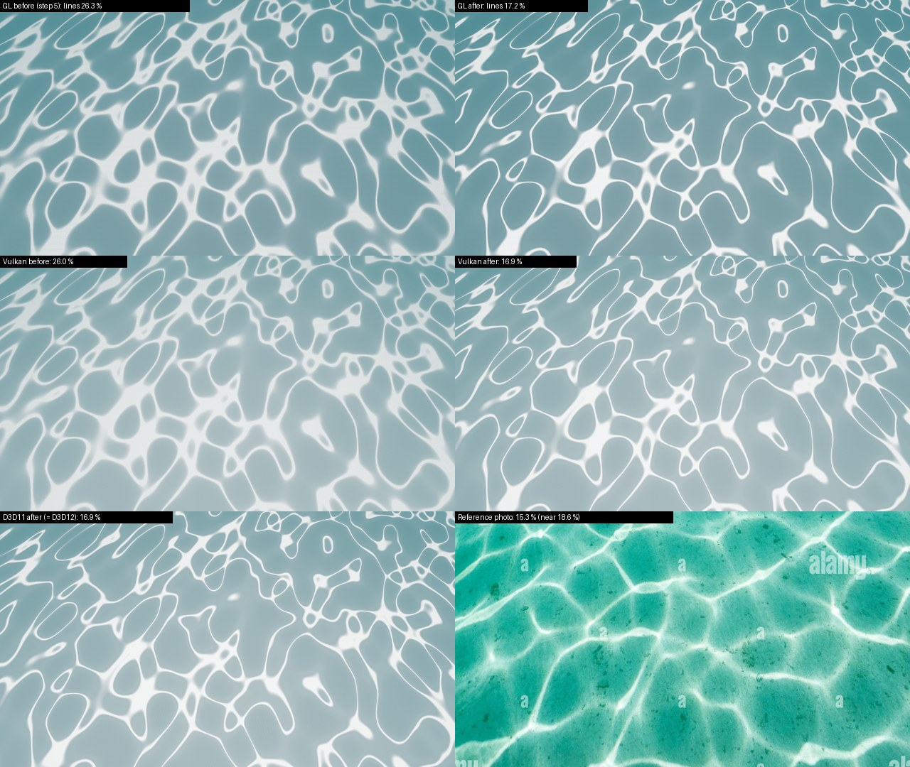
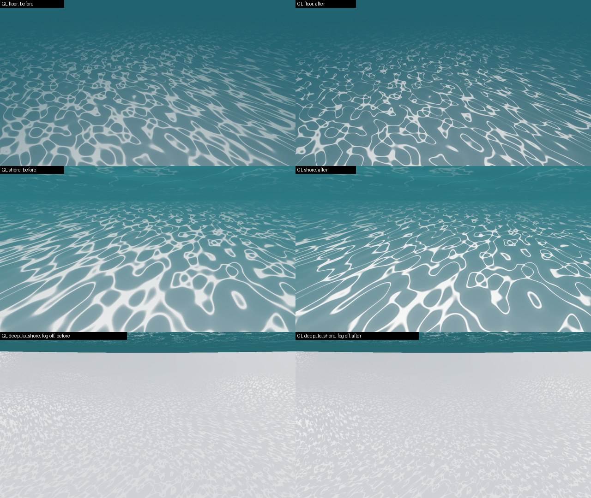
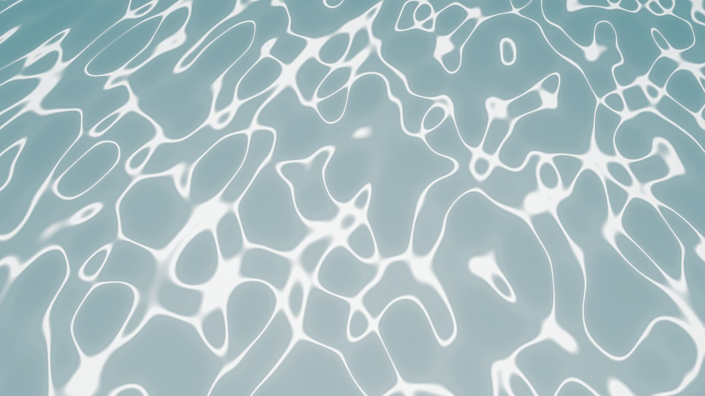
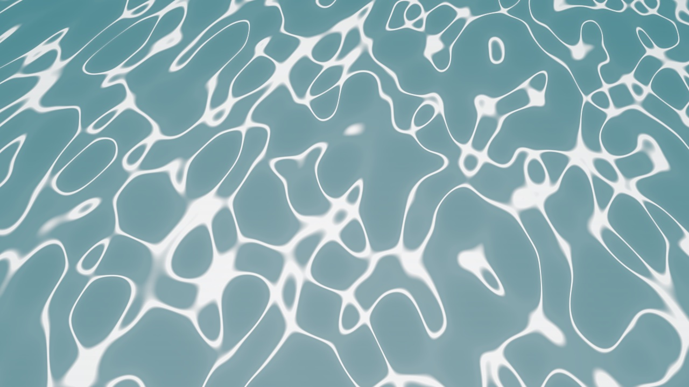

# Unterwasser-Kaustik: Linienbreite auf die Vorgabe (Thema 205, Schritt 6)

Stand 17.10.2026, NN-WS03 (NVIDIA RTX 4070), Release-Baum `C:\hw205` (eigener `DEPLOY_DIR`, wie Schritt 5).
Ausgangslage aus Schritt 4/5: im Bildausschnitt des Vorgabe-Fotos (`reference`, 0,7 m unter der Flaeche, Boden
~2,7 m tief) waren 26,0 bis 26,3 % der Pixel "Linie", im Foto 15,3 % (ganzes Bild) bis 18,6 % (nahes unteres
Zwei-Drittel). Mass: `scripts/underwater_reference_compare.py` (Luminanz, Linie = heller als cell + 0,5 (peak - cell)).

**Kurz:** Nur der Kern jeder Faltlinie leuchtet noch. `reference` jetzt **GL 17,2 %, D3D11 = D3D12 = Vulkan 16,9 %**,
Kontrast GL 1,54 -> **1,66** (Foto 1,66 bis 1,71), D3D/Vulkan 1,35 -> 1,43. Netz-Topologie, Tiefenausblendung und
Unterseite unveraendert. Metal (Schritt 7, Mac nachgezogen): `reference` **17,2 %, Kontrast 1,66**, gleich GL
(Abschnitt 6).





## 1. Ursache und Aenderung

Die Linienhelligkeit war `kGain * (J - 1)^1.5` fuer jedes J > 1, also das ganze Band |det| < 1 um eine Faltlinie;
nach dem Tonemapping ist schon J ~ 2 fast weiss. Darum breite weisse Baender statt duenner Linien.

Neu (alle vier Kopien gleich: `postfx_underwatercaustics.frag`, `HlslSources.h` kUnderwaterCausticsHLSL,
`OpenGLRenderer.cpp` kUnderwaterCausticsFS (Begruendung im Kommentar), `MetalRenderer.mm`):

```
cap = min(mix(10.0, 2.0, tD), capAA);                          // nah 10 statt 5
J   = 1.0 / max(abs(det), 1.0 / cap);
rgb = sunColor * w * kGain * pow(max(J - 1.0 - kCore * (cap - 1.0), 0.0), 1.5);   // kCore = 0.2
```

Die Schwelle haengt am wirksamen Deckel, nicht an einem festen J: mit festem J0 = 3 (Scan `o3c10`, 15,3 %) waere
das Netz in der Tiefe (Deckel 2) und in der Ferne (capAA < 3) ganz verschwunden. Der Abdunkelungsanteil der Zellen
(`kDark * (1 - J)`) und kFocal (Netzdichte, Zellgroesse) sind unveraendert.

## 2. Abstimmung (Vulkan, nur `.spv` getauscht, `reference`, Linien % / Kontrast)

| Variante | Linien % | Kontrast |
|---|---|---|
| Stand Schritt 5 | 26,0 | 1,35 |
| Deckel 8 / Deckel 8 + kGain 0,30 / kGain 0,25 / Exponent 2,5 | 23,4 / 21,6 / 23,8 / 25,8 | 1,41 / 1,38 / 1,29 / 1,44 |
| fester Abzug J-2 / J-2 + Deckel 8 / J-3 + Deckel 10 | 20,7 / 18,8 / 15,3 | 1,30 / 1,40 / 1,42 |
| **kCore 0,2 + Deckel 10 (genommen)** / 0,25 / 0,30 / 0,30 + Deckel 8 | **16,9** / 15,9 / 15,2 / 16,9 | **1,43** / 1,42 / 1,42 / 1,38 |

0,2 liegt mitten im Band 15 bis 18 % und laesst GL (+0,3) Luft nach oben.

## 3. Abnahme (je 18 Ansichten, `scripts/underwater_look_shots.py`, 1280x720)

| Beleg | GL | D3D11 | D3D12 (Debug-Layer + DRED) | Vulkan (Validation) |
|---|---|---|---|---|
| Aufnahmen OK | 18/18 | 18/18 | 18/18 (+18 ohne Debug-Layer, pixelgleich) | 18/18 |
| `[ERROR]` / `compile failed` | 0 / 0 | 0 / 0 | 0 / 0 (nur die zwei bekannten Warnungen aus 185) | 0 / 0 |
| `reference` Linien % (vorher) | **17,2** (26,3) | **16,9** (26,1) | **16,9** (26,1) | **16,9** (26,0) |
| `reference` cell / peak / Kontrast | 146 / 243 / 1,66 | 171 / 244 / 1,43 | dito | dito |
| Netz an/aus `reference` (vorher) | 17,7 (22,2) | 13,5 (16,2) | 13,5 (16,2) | 13,4 (16,1) |
| Netz an/aus `floor` (vorher) | 10,5 (11,7) | 8,8 (9,5) | 8,8 (9,5) | 8,7 (9,5) |

- Netz-aus-Bilder von Schritt 5 wiederverwendet (der Pass ist bei UWCAUSTICS=0 aus, unveraendert).
- Backends gegeneinander: D3D12 = D3D11 pixelgleich (`reference`, `floor`), Vulkan 0,3 bis 0,4 neben D3D11; D3D11 gegen
  GL weiter ~21 (die bekannte hellere D3D-Szene, Schritt 5 Abschnitt 3).
- Kontrollen gegen Schritt 5 (mittl. |Δ|, gleiches Backend): `dry_shallow` 0,00 ueberall; `up`, `zenith`, `deep_up`
  auf GL 0,00, auf D3D/Vulkan 0,0 bis 1,7 = Rauschboden aus Schritt 5. Die Unterseite (Wassermaterial) ist unberuehrt.
- Linien % in anderen Rahmen, GL (vorher): `floor` 10,7 (17,5), `shore` 12,1 (20,3), `reference_nofog` 20,2 (32,1).
  `floor`/`shore` liegen jetzt unter dem Foto: sie sind tiefer (Boden 4,9 m) und weiter weg als das Foto, die Linien
  dort entsprechend schmaler. Auf D3D/Vulkan zaehlt das Mass dort den helleren Nahboden mit (21,7 / 24,3, Schritt 5 4.4).
- Repo-`.spv` (Build) ist byte-gleich mit dem abgestimmten (`76e140a0`), Deploy-DLL = Build-DLL.

## 4. Nicht gemessen / offen

- ~~Metal nicht gelaufen~~: in Schritt 7 auf dem Mac nachgezogen, Abschnitt 6.
- Bloom: alle Abnahmebilder haben `BLOOM=0`, der HDR-Gipfel im Linienkern ist aber ~2,4x hoeher (Deckel 10). Gegenprobe
  Vulkan `reference` mit `BLOOM=1`: Linien vorher 25,7 %, nachher **18,1 %** (Kontrast 1,43); Bloom an/aus aendert das
  Bild jetzt um 2,27 statt 0,11 (mittl. |Δ|): ein schmaler Schein um die Kerne, wie im Foto, nichts brennt aus.
- Lavapipe-Fall `underwater` (CI): `floor` an/aus war 9,53 (Lauf 38731406474, RTX hier 9,51), erwartet jetzt ~8,7
  gegen die Schwelle 1,5. Metal-Syntax: der macOS-CI-Schritt "Compile-check the runtime MSL strings" kompiliert die
  MSL-Strings offline.
- Bewegung/Flimmern der schmaleren Linien (nur Standbilder; capAA haelt das Band >= 2 px wie vorher).
- GPU-Kosten (eine Subtraktion mehr, nicht gemessen), exportiertes Spiel (`deploy/*/Game` nicht neu gelinkt).
- Farbe (graublau statt tuerkis, Nebelton) und der weiche Schein neben den Linien im Foto: nicht Teil des Schritts.

## 5. ctest

`ctest --test-dir C:/hw205 -j 4` (privates `APPDATA`, `HE_NET_LOOPBACK_ONLY=1`): **286/290**, 2 uebersprungen
(`runtime_size_app_*`, wie immer), 2 rot, beide nicht vom Zweig:
- `test_contentmanager` (`:1780`): nur weil `APPDATA` mit Schraegstrichen gesetzt war (`C:/hw205/...`), der Test
  vergleicht gegen den Pfad mit Backslashes. Allein mit Backslash-Pfad (`C:\hw205\appdata6b`) gruen.
- `test_inspector_ui`: allein wieder rot an den Zwischenablage-Stellen (`:443`, `GetClipboardText` = nullptr), die
  bekannte Agenten-Sitzung auf NN-WS03 wie in Schritt 5.
- `test_underwater_camera` (Wellenzug-Abgleich der `.frag`) und `test_material_graph` gruen; `test_collab_controller`
  gruen.

## 6. Metal (Schritt 7, 17.10.2026, MacBook Air M-Serie)

Release-Baum `out/build/release` des Worktrees, `--target HorizonEditor` (ninja baute nur `MetalRenderer.mm` und
`OpenGLRenderer.cpp` neu, die einzigen Quelltexte seit Schritt 4; `libHorizonRendering.dylib` im Deploy enthaelt den
MSL-Text mit `kCore = 0.2`). Alle 18 Ansichten mit `scripts/underwater_look_shots.py --rhi Metal`, 18/18 OK, 0 `[ERROR]`
/ `compile failed` in den Logs; dazu GL `reference` im selben Deploy, und vor dem Neubau `reference` mit dem alten
Deploy (Stand Schritt 4) als Vorher-Bild.



| `underwater_reference_compare.py` | cell | peak | Kontrast | Linien % |
|---|---|---|---|---|
| Foto ganz (`0,0,1,0.93`) / unteres Zwei-Drittel (`0,0.33,1,0.93`) | 139 / 145 | 238 / 241 | 1,71 / 1,66 | 15,3 / 18,5 |
| `reference` Metal vorher (alter Deploy) | 148 | 228 | 1,54 | 26,4 |
| **`reference` Metal nachher** | **147** | **243** | **1,66** | **17,2** |
| `reference` GL nachher (Mac, gleicher Deploy) | 147 | 243 | 1,66 | 17,2 |
| `reference_nofog` Metal vorher / nachher | | | 1,26 / 1,29 | 32,1 / 20,3 |
| `floor` / `shore` Metal nachher (GL Schritt 6: 10,7 / 12,1) | | | 2,42 / 2,17 | 10,8 / 12,2 |

- Metal gegen GL (mittl. |Δ| je Kanal): alle 18 Ansichten 0,004 bis 0,63, `reference` 0,33 (max 11); genau die Werte
  von Schritt 4 (`dry_shallow` 0,63 / 8 % > 2 in der Himmelsspiegelung, `zenith` 0,17/0,19), das Netz weicht also
  zwischen den zwei Mac-Backends nicht weiter ab als vorher.
- Netz an/aus (`HE_DUMP_UWCAUSTICS=0`, Metal): `reference` 17,70 (vorher 22,22), `floor` 10,56 (vorher 11,73); GL
  Schritt 6: 17,7 / 10,5.
- Vorher/nachher auf Metal: `reference` 8,63, `reference_nofog` 5,48 (nur das Netz). Unberuehrt: `up` md5 `73aa998c`,
  `dry_shallow` `c1c8dede`, beide gleich Schritt 3/4 (Unterseite und Oberseite unveraendert).
- Nicht gemacht: ctest (keine Code-Aenderung in Schritt 7, nur dieser Bericht und ein Bild); Bewegung, GPU-Kosten.
- CI 39016248197 (Commit d97d0a1a, Code von Schritt 6) war gruen, damit auch der MSL-Offline-Check und der
  lavapipe-Fall `underwater`.

## Handoff

- **Schritt 7 (Metal, Mac):** `reference` Metal 17,2 % / Kontrast 1,66 = GL, Metal-GL 0,004 bis 0,63 wie Schritt 4,
  `up`/`dry_shallow` md5-gleich zu Schritt 3/4 (Abschnitt 6). Bilder in `/tmp/uw7` (nicht im Repo), eines in
  `docs/images/underwater-linewidth-reference-metal.jpg`. Metal ist damit abgenommen; offen bleiben Bewegung,
  GPU-Kosten, exportiertes Spiel, Farbe/Nebelton und der weiche Schein neben den Linien.

- **Topic / step:** Thema 205, Schritt 6 (Kaustik-Liniendichte 26 % -> 15 bis 18 %)
- **Branch / commit:** `claude/unterwasser-postfx-wirkt-billig-caustics-wasseroberfl-chen-u`, Commit "Underwater caustics
  line width (Thema 205 step 6)"
- **Done:** Linien nur noch im Kern (kCore 0,2, Deckel nah 10) in allen vier Shaderkopien; `reference` 16,9 bis 17,2 %
  auf GL/D3D11/D3D12/Vulkan, GL-Kontrast = Foto.
- **Files touched:** `src/HE_Rendering/shaders/postfx_underwatercaustics.frag` (kCore, cap),
  `src/HE_Rendering/src/Backends/D3D_Shared/HlslSources.h` (dito), `src/HE_Rendering/src/Backends/OpenGL/OpenGLRenderer.cpp`
  (dito + Begruendung), `src/HE_Rendering/src/Backends/Metal/MetalRenderer.mm` (dito), dieses Dokument, 3 Bilder.
- **Verified:** Abschnitt 3 (Aufnahmen in `C:\hw205\shots6\<Backend>`, Abstimmung in `C:\hw205\tune`, nicht im Repo), ctest.
- **Not verified:** Metal (Bild und Kompilat), Bewegung, GPU-Kosten, exportiertes Spiel.
- **Decisions taken:** Schwelle relativ zum Deckel statt festem J (Tiefe/Ferne behalten ihr Netz); kFocal/kDark/kGain
  unveraendert (Dichte und Zellen bleiben, nur die Breite aendert sich); `Water.hasset` nicht angefasst.
- **Decisions suggested, not taken:** weicher Schein neben dem Linienkern wie im Foto (z. B. kleiner linearer Term,
  Luft bis 18 %); Farbton (Nebel) eigener Schritt.
- **Traps:** schnellste Schleife = `.frag` per glslc direkt nach `deploy/Editor/Shaders` kompilieren und nur Vulkan
  schiessen (2 s pro Bild, kein C++-Build); `reference` stimmt zwischen den Backends auf 0,3 Prozentpunkte. D3D12-Debug-
  Layer nur mit `HE_GPU_DEBUG=1`.
- **Next steps:** ~~1. Mac: Metal-Bild~~ (Schritt 7 erledigt). ~~2. CI-Lauf~~ (39016248197 gruen). Danach: weicher
  Schein neben den Linien / Farbe (Nebelton) als eigene Schritte, falls der Mensch das will.
