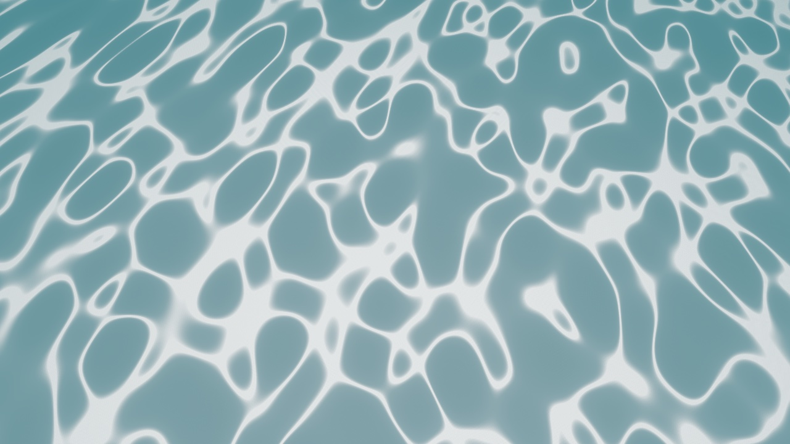
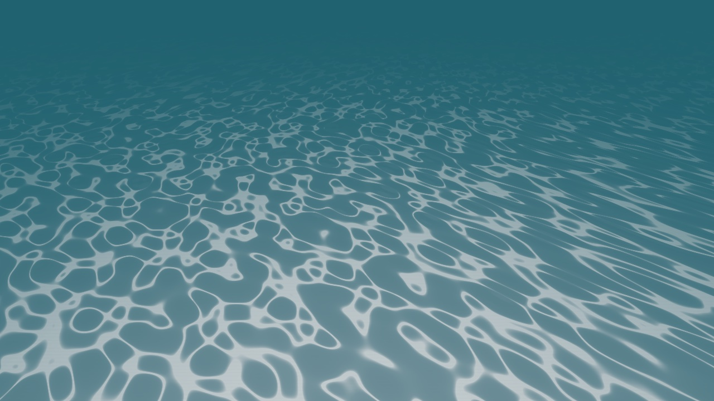

# Unterwasser-Look: Abnahme (Thema 205, Schritt 4)

Stand 15.10.2026, MacBook Air (M5), Release-Baum `out/build/release`. Gegenstand: Schritt 2 (Kaustik-Netz, 7c154711)
und Schritt 3 (Unterseite im Wassermaterial, 6b6c165f). Vorgabe-Bild des Menschen: Foto eines sandigen Flachwasser-
bodens mit feinem Lichtnetz (Hive-Datei 32, `sandy-shallow-sea-depth-...-EWM61N.jpg`).

**Kurz:** Metal und OpenGL sind abgenommen (Bilder, Zahlen, Tests). D3D11, D3D12 und Vulkan zur Laufzeit sind
**nicht** abgenommen: NN-WS03 war den ganzen Schritt offline. Dafuer laeuft jetzt ein Unterwasserfall im
lavapipe-Job (Vulkan in Software, unter dem Validation-Layer); die Hardware-Abnahme ist Schritt 5 (Queen, Anfrage 98).

## 1. Build und Tests (Mac)

- `ninja -j8 HorizonEditor he_tests mat_gen`: nichts zu tun, Schritt 3 hatte den Baum schon gebaut. Deploy
  (`out/deploy/Editor`) byte-gleich zum Build-Baum (Exe + alle `libHorizon*.dylib`, `cmp`).
- `mat_gen` zweimal: `Water.hasset` beide Male md5 `c81b8ae9`, gleich Repo und Deploy.
- `HOME=<leer> ctest -j4` (shaderc an): **288/289**, 2 uebersprungen (`runtime_size_app_*`, wie immer). Rot nur
  `test_collab_controller` (:2922, 869 s, lief parallel zu den Editor-Aufnahmen); allein nachgelaufen gruen in 22 s.
  Derselbe Test ist auch der einzige rote Fall im macOS-CI von Schritt 3 (Lauf 38723420944, :3871 `tickUntil`); der
  Zweig aendert keine Collab-Datei. Linux, Windows und lavapipe waren in dem Lauf gruen. Der CI-Fall ("Settle: a
  client's save and a quiet scene reach the host's keep step") lokal 10x nacheinander und 8x parallel: 18/18 gruen,
  nicht reproduzierbar, also Timing-Flake (Anfrage 99 der Queen). Der CI-Lauf dieses Commits ist der Rerun. Lesson 349.

## 2. Bilder: Metal und OpenGL

`scripts/underwater_look_shots.py` (alle Ansichten, je mit und ohne Nebel) auf beiden Backends, 36 Aufnahmen, alle OK.
Neu ist die Ansicht `reference`: 0,7 m unter der Flaeche, 50 Grad nach unten auf etwa 2,7 m tiefen Boden, also der
Bildausschnitt des Vorgabe-Fotos.

- **Reproduzierbar:** `up` md5 `73aa998c`, `dry_shallow` `c1c8dede`, beide gleich dem Handoff von Schritt 3.
- **Metal gegen OpenGL** (mittlere |Δ| je Kanal, 0 bis 255): alle Unterwasser-Ansichten 0,004 bis 0,45 (Spitze
  `reference` 0,45, max 8). `zenith` 0,17/0,19 mit Einzelpixeln bis 29 am Fensterrand. Die Oberseite von oben
  (`dry_shallow`) 0,63, 8 % der Pixel > 2: verteilt ueber die Himmelsspiegelung, mit dem Auge nicht zu sehen,
  und Schritt 3 hat die Oberseite nicht veraendert.
- **Netz an/aus** (`HE_DUMP_UWCAUSTICS=0`, Metal): `floor` 11,73, `floor_nofog` 13,02, `reference` 22,22. Zum
  Vergleich Thema 185: 0,63. Das Netz ist jetzt da, wo es vorher fehlte.

## 3. Gegen das Vorgabe-Foto

`scripts/underwater_reference_compare.py` misst auf Foto und Aufnahme dasselbe: Luminanz, `cell` = 25. Perzentil
(Boden zwischen den Linien), `peak` = 99. Perzentil, `lines` = Anteil der Pixel ueber der Mitte zwischen beiden.

| Bild | cell | peak | Kontrast | Linien % |
|---|---|---|---|---|
| Foto (ohne Bildunterschrift) | 139 | 238 | 1,71 | 15,3 |
| Foto, unteres Zwei-Drittel (nah) | 145 | 240 | 1,66 | 18,2 |
| `reference` Metal (= GL) | 148 | 228 | 1,54 | 26,4 |
| `reference_nofog` | 197 | 249 | 1,26 | 32,1 |
| `shore` (1 m tief, zum Ufer) | 113 | 233 | 2,06 | 20,3 |
| `floor` (5 m Abstand, 185-Rahmen) | 90 | 195 | 2,17 | 17,6 |

Was passt: ein zusammenhaengendes Netz aus Zellen statt Ovale, im Flachen am staerksten, Kontrast in der Naehe wie
im Foto (1,5 gegen 1,7), Linienanteil aus 5 m Abstand wie im Foto (17,6 %).

Was nicht passt (Befund, nicht geaendert, das ist Abstimmung fuer den Menschen):
1. **Nah sind die Linien zu breit:** 26 % statt 15 bis 18 %. Im Foto sind es scharfe, duenne Linien auf einem fast
   gleichmaessigen Boden; bei uns laufen sie an Knoten zu breiten hellen Flaechen zusammen. Stellschraube:
   Linienkappe/Breite im Kaustik-Pass (Schritt 2, `postfx_underwatercaustics.frag` und die drei Kopien).
2. **Ohne Nebel saettigt das Netz** (Kontrast 1,26): der Zeugenboden ist hellgrau ohne Textur. Mit Sand- oder
   Grastextur waere das ein anderes Bild; dafuer gibt es keinen Zeugen.
3. **Farbe:** Foto tuerkis (Sand + flaches klares Wasser), bei uns graublau. Das ist der Nebelton (0,45 je Meter,
   Thema 185), nicht die Kaustik.
4. **Unterseite (`up`, `zenith`):** Snell-Fenster, Totalreflexion, gebrochene Sonne sind da und auf GL gleich. Das
   Netz dort liest sich aber eher als einzelne Risslinien als ein Lichtnetz (Isolinien zweier FBM-Felder). Schritt 3
   hat schon vorgeschlagen, es aus der Wellenkruemmung wie am Boden zu bauen.

## 4. D3D11, D3D12, Vulkan

- **Hardware: nicht abgenommen.** NN-WS03 offline (zuletzt 13 h vor diesem Schritt). Laut Vorgabe des Menschen
  bleibt das offen und wird nicht per CI als erledigt gemeldet. Schritt 5 (Queen): `underwater_look_shots.py --rhi
  D3D11|D3D12|Vulkan` auf NN-WS03 und `scripts/underwater_acceptance.py --compare` gegen die Mac-Bilder.
- **Was CI belegt:** die HLSL/SPIR-V-Fassungen kompilieren (he_tests "Every standard node cross-compiles",
  `test_engine_materials` Water nach GLSL/MSL/HLSL/SPIR-V); Windows-Job im Lauf von Schritt 3 gruen.
- **Neu im lavapipe-Job:** Fall `underwater` in `scripts/he_vk_imagetests.py`: `floor` gegen `floor_off`
  (Netz muss das Bild um mehr als 1,5 aendern; Metal 11,73, Vulkan sättigt auf seinem helleren Boden) und `up`
  (Snell-Fenster heller als der Spiegel darunter, Metal RGB-Summe 557 gegen 244), alle drei ohne Validation-Meldung.
  Gegen die Metal-Bilder lokal geprueft (die Checks greifen); auf lavapipe selbst noch nie gelaufen, der erste
  CI-Lauf liefert die Zahlen. Software-Vulkan ersetzt die Hardware-Abnahme nicht.

## 5. Nicht gemessen

GPU-Kosten (Netz ohne Kostendeckel seit Schritt 2, Unterseite verzweigungsfrei seit Schritt 3), Bewegung/Flimmern
(nur Standbilder), Regen von unten (Schritt 3: heLitP laesst bei `wet` etwas Spiegelung durch).

## Handoff

- **Topic / step:** Thema 205, Schritt 4 von 4 (Schritt 5 Windows-Abnahme haengt die Queen an)
- **Branch / commit:** `claude/unterwasser-postfx-wirkt-billig-caustics-wasseroberfl-chen-u`, Commit "Underwater look
  acceptance (Thema 205 step 4)" (gepusht)
- **Done:** Mac-Abnahme: Build, ctest, 36 Aufnahmen Metal/GL, Vergleich mit dem Vorgabe-Foto in Zahlen, lavapipe-Fall.
- **Files touched:** `scripts/underwater_look_shots.py` (Ansicht `reference`), `scripts/underwater_reference_compare.py`
  (neu), `scripts/he_vk_imagetests.py` (Fall `underwater`), dieses Dokument, 3 Bilder.
- **Verified:** siehe Abschnitte 1 bis 3 (Befehle und Zahlen dort).
- **Not verified:** D3D11/D3D12/Vulkan auf Hardware; der lavapipe-Fall auf lavapipe (erster CI-Lauf); GPU-Kosten; Bewegung.
- **Decisions taken:** Kein Shader-Abstimmen in diesem Schritt (Abnahme, nicht Rework); Befunde 3.1 bis 3.4 an den Menschen.
  Schwelle 1,5 im lavapipe-Fall bewusst weit (Vulkan-Boden heller, Netz saettigt; 185 mass dort 0,37x GL).
- **Decisions suggested, not taken:** Linien nah schmaler (Ziel 15 bis 18 % Linienanteil in `reference`);
  Unterseiten-Netz aus der Wellenkruemmung; Zeugenboden mit Sandtextur.
- **Traps:** `test_collab_controller` ist unter Last rot (Lesson 349). Kein PIL/numpy auf dem Mac: Bildmessung mit
  `struct` (`he_vk_imagetests.read_bmp`, `underwater_reference_compare.py` nimmt JPG/PNG per `sips`).
- **Next steps:** 1. CI-Lauf dieses Commits: Fall `underwater` im lavapipe-Job lesen (Zahlen in metrics.json),
  Schwelle auf die Haelfte des gemessenen Werts nachziehen. 2. Schritt 5 auf NN-WS03 (Abschnitt 4).
  3. Wenn der Mensch die Befunde 3.1/3.4 will: eigener Schritt.
