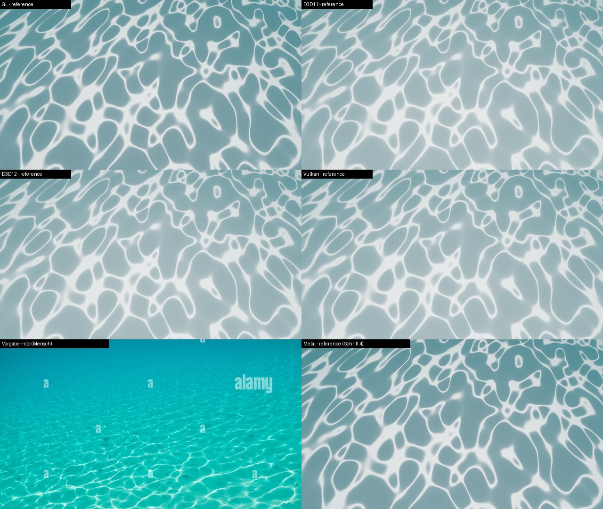
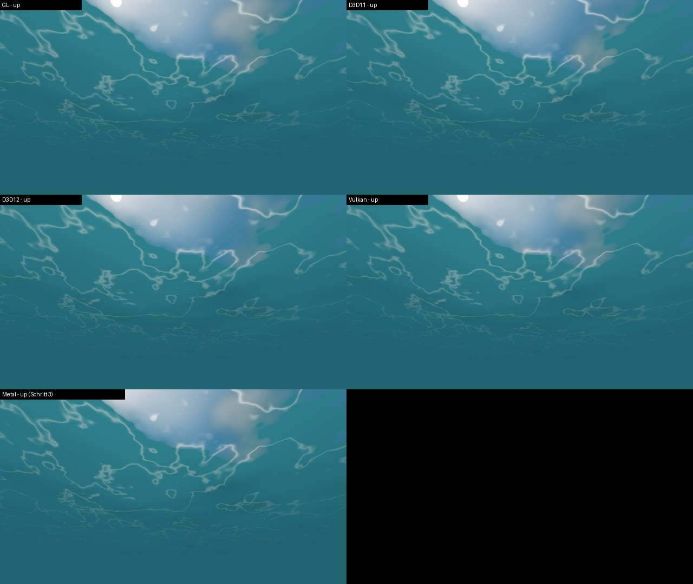
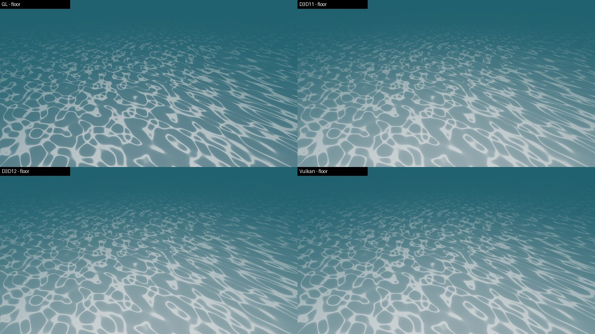

# Unterwasser-Look: Windows-Abnahme D3D11, D3D12, Vulkan (Thema 205, Schritt 5)

Stand 17.10.2026, NN-WS03 (NVIDIA RTX 4070), Release, privater Baum `C:\hw205` mit eigenem `DEPLOY_DIR`, Zweig-Stand
ee8e4bd1 (Schritte 2 bis 4). Vorgehen wie Schritt 4 (`docs/underwater-look-acceptance-2026-10-15.md`): dieselben
18 Ansichten (`scripts/underwater_look_shots.py`, jede mit und ohne Nebel) auf OpenGL, D3D11, D3D12 und Vulkan, dazu
Netz-aus-Kontrollen und Wiederholungslaeufe. Auswertung `scripts/underwater_backend_compare.py` (neu).

**Kurz:** Kaustik-Netz und Unterseite laufen auf allen drei Backends und sehen aus wie auf Metal/OpenGL. D3D12 ist unter
Wasser pixelgleich zu D3D11, Vulkan weicht hoechstens 0,6/255 ab. Gegen das Vorgabe-Foto gilt der Befund aus Schritt 4
auf jedem Backend: Linienanteil 26,0 bis 26,3 % gegen 15 bis 18 % im Foto, die Linien sind nah zu breit.

## 1. Build, Deploy, Tests

- `cmake --preset x64-release -B C:/hw205 -DDEPLOY_DIR=C:/hw205/deploy`, `--target HorizonEditor he_tests mat_gen -j 8`: gruen.
- Deploy = Repo: `Water.hasset` md5 `c81b8ae9` (wie Schritt 4), `postfx_underwatercaustics/-fog.frag.spv` im Deploy
  gleich dem Build-Baum. Alle Aufnahmen 1280x720.
- `mat_gen` unter MSVC schreibt `Water.hasset` zweimal gleich (`54812863`), aber nicht byte-gleich zum Mac (`c81b8ae9`):
  nur die Knotennummern im erzeugten Shadertext sind anders (`n224` gegen `n176`, gleich viele Zeilen). MSVC wertet
  verschachtelte Builder-Aufrufe in anderer Reihenfolge aus. Das Repo-Asset bleibt das vom Mac; nicht ersetzt.
- ctest (privates `APPDATA`, `HE_NET_LOOPBACK_ONLY=1`, `-j 4`): siehe Abschnitt 6.

## 2. Laeuft es wirklich? (je Backend)

| Beleg | GL (Win) | D3D11 | D3D12 | Vulkan |
|---|---|---|---|---|
| Aufnahmen OK, Exit | 18/18, 0 | 18/18, 0 | 18/18, 0 | 18/18, 0 |
| `[ERROR]` in 18 Logs | 0 | 0 (kein Debug-Layer) | 0 (Debug-Layer + DRED an) | 0 (Validation an) |
| Material-Shader | GLSL gebaut | HLSL kompiliert, 0 `compile failed` | dito | SPIR-V |
| Netz an/aus `reference` (mittl. \|Δ\|) | 22,16 | 16,15 | 16,15 | 16,10 |
| Netz an/aus `floor` | 11,66 | 9,54 | 9,54 | 9,51 |
| Snell-Fenster `up`: RGB-Summe Fenster / unter dem Rand | 554 / 244 | 554 / 244 | 554 / 244 | 554 / 244 |

- Metal (Schritt 4): Netz an/aus `reference` 22,22, `floor` 11,73; Snell 557 / 244. Windows-GL trifft Metal.
- D3D12 meldet je Lauf nur die zwei allgemeinen Warnungen, die Thema 185 schon notiert hat (Pixel-Shader mit Ziel 3
  in einem PSO ohne RTV 3; Clear-Wert). Die Unterwasser-Passes betrifft das nicht.
- GPU: der Editor-Prozess aus `C:\hw205\deploy` stand waehrend der D3D12-Serie in `nvidia-smi` (RTX 4070).
- Netz-aus-Schalter erreicht den Koerper: Log `caustics set intensity 0.00` in jeder Aus-Aufnahme.

## 3. Backends gegeneinander (mittl. \|Δ\| je Kanal, 0..255)

| Ansicht | GL gegen Metal | D3D11 gegen GL | D3D12 gegen D3D11 | Vulkan gegen D3D11 | Rauschboden (2. Lauf) D3D11 / D3D12 / Vulkan |
|---|---|---|---|---|---|
| `up` (Unterseite) | 0,07 | 0,76 | 0,38 | 0,72 | 0,26 / 0,42 / 0,12 |
| `zenith` | 0,19 | 2,34 | 1,59 | 2,66 | 0,41 / 1,55 / 0,02 |
| `deep_up` | 0,06 | 0,67 | 0,22 | 0,77 | – |
| `reference` | 1,11 (JPG) | 19,44 | 0,00 | 0,59 | 0 / 0 / 0 |
| `floor` | 1,27 (JPG) | 12,71 | 0,00 | 0,37 | 0 / 0 / 0 |
| `dry_shallow` (trocken, ueber Wasser) | – | 25,01 | 0,00 | 0,57 | 0 / 0 / 0 |

- **Unterseite:** D3D/Vulkan liegen 0,4 bis 3 neben GL/Metal, der Rauschboden derselben Ansicht ist 0,02 bis 1,55
  (Himmel und Sonne im Fenster bewegen sich auf D3D mit der Laufzeit). Kein Backend fehlt etwas.
- **Boden 12 bis 26 neben GL ist nicht das Netz:** schon mit Netz aus liegt D3D11 um 15,5 (`floor_off`) bzw. 26,1
  (`reference_off`) neben GL, und trocken ueber dem See um 25. Das ist die bekannte hellere D3D/Vulkan-Szene (Thema 185,
  Abschnitt 8.1: ~25). Der Beitrag des Netzes allein (an minus aus) korreliert zwischen GL und D3D11 mit 0,991 (`floor`)
  bzw. 0,995 (`reference`): dieselben Linien an denselben Stellen. Auf dem helleren Boden ist er etwa 0,7x so stark
  (Blend saettigt), Thema 185 hatte dort 0,37x.

## 4. Gegen das Vorgabe-Foto (`underwater_reference_compare.py`, Luminanz)

| Bild | cell | peak | Kontrast | Linien % |
|---|---|---|---|---|
| Foto (ohne Bildunterschrift) | 139,6 | 238,6 | 1,71 | 15,3 |
| Foto, unteres Zwei-Drittel (nah) | 145,4 | 241,4 | 1,66 | 18,6 |
| `reference` GL (Win) / Metal-JPG | 147,9 / 148,1 | 228,4 / 228,2 | 1,54 | 26,3 / 26,4 |
| `reference` D3D11 = D3D12 = Vulkan | 172,5 | 232,4 | 1,35 | 26,1 / 26,1 / 26,0 |
| `reference_nofog` GL / D3D-Vulkan | 196,5 / 222,6 | 249 / 250 | 1,27 / 1,12 | 32,1 / 30,3 |
| `floor` GL / D3D-Vulkan | 89,8 / 93,4 | 195 / 205 | 2,17 / 2,20 | 17,5 / 32,0 |
| `shore` GL / D3D-Vulkan | 113,1 / 118,8 | 232 / 236 | 2,06 / 1,98 | 20,3 / 35,5 |

Soll/Ist:
1. **Netz statt Ovale, im Flachen am staerksten:** Soll erfuellt auf allen Backends (Bilder oben, Netz an/aus Abschnitt 2).
2. **Linienbreite nah:** Soll 15 bis 18 % wie im Foto, Ist 26 % auf allen fuenf Backends. Der Befund aus Schritt 4 ist
   also kein Metal/GL-Effekt. Stellschraube unveraendert: Linienkappe/-breite im Kaustik-Pass.
3. **Kontrast nah:** Foto 1,66 bis 1,71, GL/Metal 1,54, D3D/Vulkan 1,35. Auf D3D/Vulkan flacher, weil der Boden
   zwischen den Linien heller ist (cell 172 statt 148), nicht weil das Netz schwaecher waere.
4. **`floor`/`shore` auf D3D/Vulkan 32 bis 36 % Linien** (GL 17 bis 20 %): der hellere Nahboden der D3D-Szene (untere
   Bildhaelfte 146 statt 121 mit Netz aus) hebt grosse Bodenflaechen ueber die Mitte zwischen cell und peak. Das Mass
   zaehlt dort Boden als Linie; die Linien selbst sind dieselben (Korrelation 0,99, Bild `floor` oben).
5. **Farbe:** Foto tuerkis, bei uns graublau auf allen Backends (Nebelton, wie Schritt 4, Befund 3).

## 5. Nicht gemessen

GPU-Kosten (die Pass-Zeit-Messung `underwater_acceptance.py --gputime` lief nicht), Bewegung/Flimmern (Standbilder),
Regen von unten, das exportierte Spiel (nur Editor-Dump).

## 6. ctest

`ctest --test-dir C:/hw205 -j 4` (privates `APPDATA`, `HE_NET_LOOPBACK_ONLY=1`): **289/290**, 2 uebersprungen
(`runtime_size_app_*`, wie immer). Rot nur `test_inspector_ui`, allein nachgelaufen wieder rot, an genau den
Zwischenablage-Stellen (`test_inspector_ui.cpp:443/508`, `GetClipboardText` liefert nullptr): die bekannte
Agenten-Sitzung auf NN-WS03, kein Zweig-Thema (der Zweig aendert keinen Inspector-/Zwischenablage-Code; Windows-CI
von Schritt 3 und 4 gruen). `test_collab_controller` war hier gruen.

CI von Schritt 4 (Lauf 38731406474): rot nur macOS, wieder `test_collab_controller.cpp:3871` (`tickUntil`), wie bei
Schritt 3; Windows, Linux und lavapipe gruen, also auch der neue lavapipe-Fall `underwater`.

## Handoff

- **Topic / step:** Thema 205, Schritt 5 (Windows-Abnahme D3D11/D3D12/Vulkan)
- **Branch / commit:** `claude/unterwasser-postfx-wirkt-billig-caustics-wasseroberfl-chen-u`, Commit "Underwater
  Windows acceptance (Thema 205 step 5)"
- **Done:** Release-Build NN-WS03, 72 Aufnahmen + 16 Netz-aus + 20 Wiederholungen, Tabellen Abschnitte 2 bis 4, ctest.
- **Files touched:** `scripts/underwater_look_shots.py` (Windows: Thema-185-Runner mit Kill nach Dump, PNG per PIL),
  `scripts/underwater_reference_compare.py` (PIL statt sips, Laufwerksbuchstabe im `path:box`), 
  `scripts/underwater_backend_compare.py` (neu, numpy+PIL), dieses Dokument, 3 Bilder.
- **Verified:** Abschnitte 2 bis 4 (Befehle oben; Aufnahmen in `C:\hw205\shots\<Backend>`, nicht im Repo).
- **Not verified:** GPU-Kosten, Bewegung, exportiertes Spiel, D3D11 ohne Debug-Layer (nur Bildbeleg).
- **Decisions taken:** Kein Shader-Abstimmen (Abnahme). Mac-`Water.hasset` bleibt, obwohl MSVC-`mat_gen` anders nummeriert.
- **Decisions suggested, not taken:** Linien nah schmaler (Ziel 15 bis 18 % in `reference`, jetzt auf allen Backends
  belegt); fuer das Linienmass auf D3D den Boden pro Backend mit Netz aus normieren, statt cell/peak absolut.
- **Traps:** `mat_gen` ist nicht compiler-uebergreifend byte-gleich (Knotennummern): md5-Vergleiche nur auf demselben
  System. `Remove-Item Env:X` wird vom Werkzeug-Schutz geblockt, `$env:X=$null` nehmen. Ohne privates `APPDATA` setzt
  ctest die Editor-Konfiguration des Menschen zurueck.
- **Next steps:** 1. Mensch entscheidet ueber Befund 4.2 (Linienbreite) und 4.5 (Farbe) -> eigener Schritt.
  2. GPU-Kosten auf NN-WS03 mit `underwater_acceptance.py --gputime` (Netz seit Schritt 2 ohne Kostendeckel).
