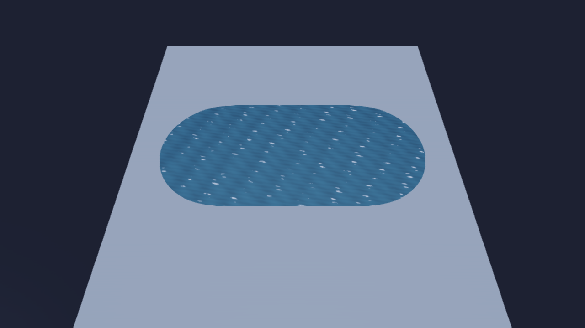
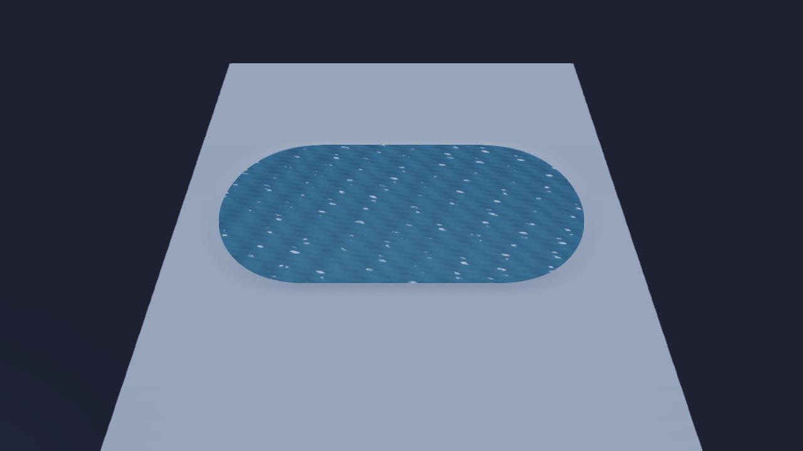
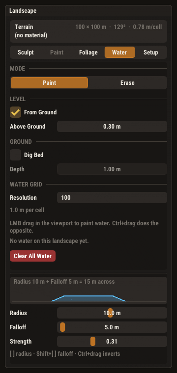
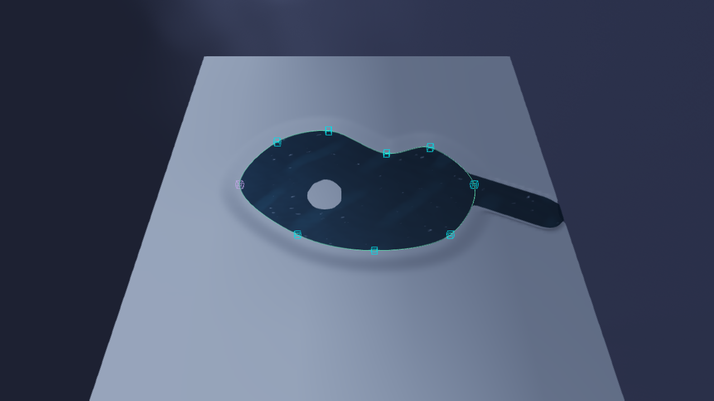
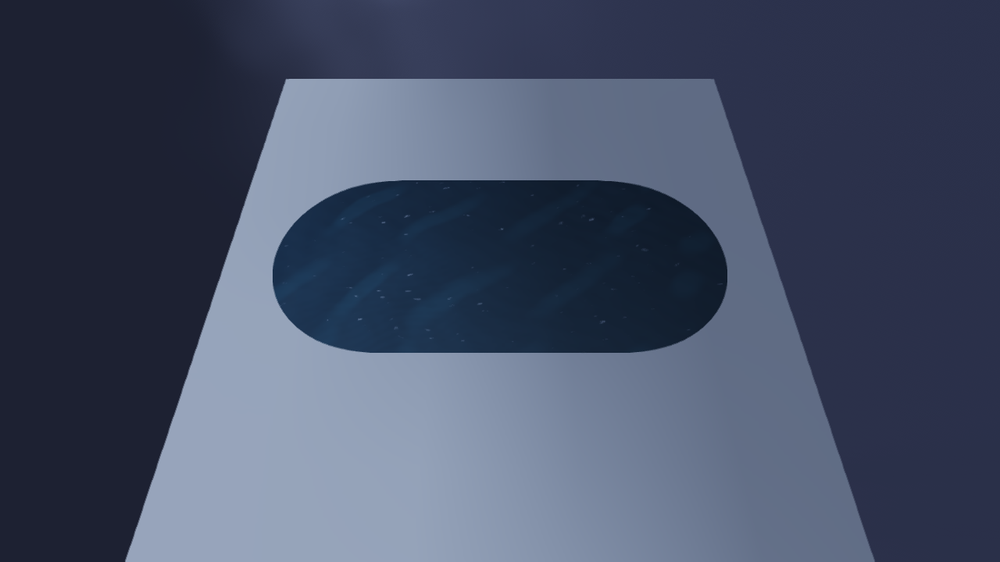
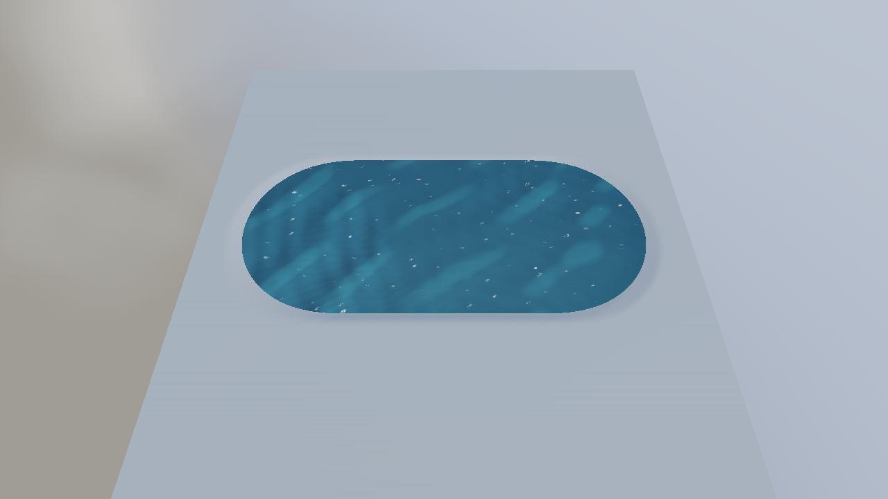
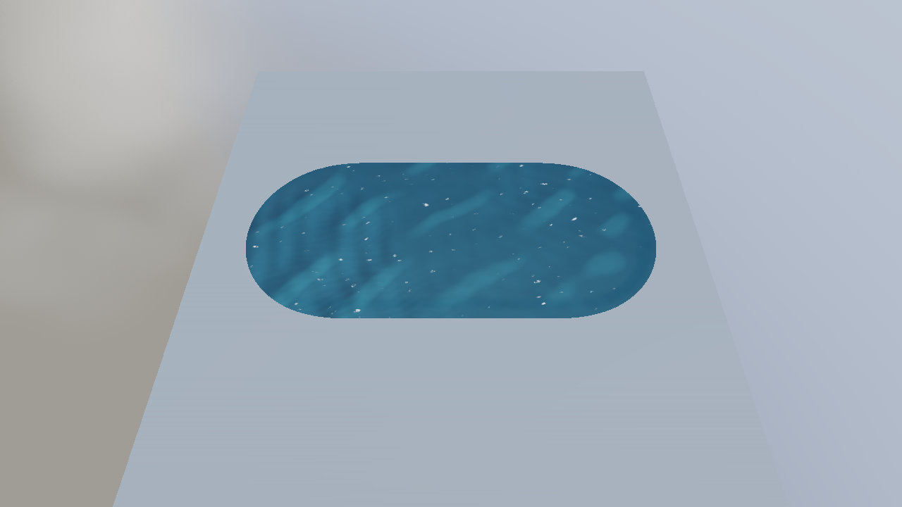

# Wasser-Pinsel: Wasser wie ein Sculpt-Werkzeug ins Landscape malen (Thema 174, Schritt 7)

Stand 09.10.2026, Windows (NN-WS03), Debug-Build. Schritt 3 lieferte das gemeinsame Wassermodell
(`HE::water::Field`), Schritt 4/5 die Fläche samt Ufer-Beschneidung. Dieser Schritt ist das zweite
Werkzeug, das in dasselbe Modell schreibt: ein Pinsel nach dem Vorbild des bestehenden Sculpt-Werkzeugs
(Cursor-Kreis, Radius, Stärke, Falloff, Ziehen malt), nicht die Spline/das Lake-Werkzeug (Schritt 8,
nicht angefasst).

Code: `src/HE_Scene/include/HorizonScene/WaterBrush.h` + `src/HE_Scene/src/WaterBrush.cpp` (der
Strich, ohne ImGui — `begin`/`dab`/`end`/`targetAt`), `src/HE_Scene/include/HorizonScene/TerrainSculpt.h`
+ `.cpp` (`lowerToFloor`, neu, fürs Absenken), `src/HE_Editor/TerrainTools.cpp` (Wasser als vierter
Landscape-Modus neben Sculpt/Paint/Foliage), `src/HE_Editor/EditorHelp.cpp` (Hilfetexte), Witness
`HE_DUMP_WATERBRUSH` in `src/HE_Editor/EditorApplication.cpp`. Tests in `tests/test_water_brush.cpp`
(16 Fälle: Datenmodell, Strich-Logik, Aushub, Undo, Speichern/Laden) und `tests/test_terrain_tools_ui.cpp`
(1 Fall: der echte Modus + Viewport headless, mit Panel-Screenshot).

## Ablauf in einem Absatz

Ein Strich ist `begin()`, beliebig viele `dab()`, `end()` — alles reine CPU-Funktionen auf
`TerrainComponent`, ohne ContentManager oder Renderer, wie `WaterField` und `TerrainSculpt` es schon
sind. `begin()` entscheidet, welcher Körper den Strich bekommt: liegt der erste Punkt auf Wasser
(`HE::water::bodyAt`), geht der Strich mit DESSEN Körper und Spiegel weiter — das ist die
Interoperabilität, die der Plan verlangt, ein Pinsel kann so später einen See (Schritt 8) verbreitern.
Liegt er auf trockenem Grund, legt `begin()` einen neuen Körper an, ohne Quell-Spline ("Pinselwasser").
Der Spiegel wird einmal, beim ersten Punkt, festgelegt und bleibt für den ganzen Strich fest (ein Zug
bergauf kippt das Wasser nicht): entweder die Geländehöhe unter dem ersten Punkt plus ein Versatz, oder
eine feste Zahl aus dem Panel. `dab()` ruft `water::addCircle`/`removeCircle` wie bisher, mit Radius/
Falloff/Stärke des Pinsels; im optionalen Grabmodus zusätzlich `TerrainSculpt::lowerToFloor` (neu, unten)
auf denselben Kreis. Der Editor (`TerrainTools.cpp`) nimmt dieselbe Mausführung wie Sculpt/Paint/
Foliage: ein Undo-Snapshot beim ersten Dab, `TerrainSystem::updateTerrains` nach jedem Dab, damit die
Fläche live mitwächst.

## Entscheidungen

| Frage | Entscheidung | Grund |
|---|---|---|
| Welcher Körper | unter dem ersten Punkt fortsetzen (`bodyAt`), sonst neu | Macht Pinsel und spätere Seen (Schritt 8) interoperabel, ohne dass der Nutzer eine Körper-Id wählen muss; ein Strich über zwei Gewässer hält sich an das erste. |
| Spiegel | beim ersten Punkt fest, aus Geländehöhe + Versatz ODER einer Zahl | Ein Zug über geneigtes Gelände darf das Wasser nicht kippen; "aus Gelände" ist der Normalfall (ein Klick ergibt sofort einen plausiblen Spiegel), die Zahl ist für einen zweiten Teich auf exakt demselben Niveau. |
| Löschen | eigener Stroke-Zustand (`erase`), beim ersten Dab fest, nicht pro Dab neu gelesen | Deckt sich damit, wie die Umkehr-Taste im Editor einmal pro Frame gelesen wird (Strg, seit dem neuen Landscape-Panel für alle Pinsel; vorher Shift), und mit dem Grow/Erase-Vorbild des Foliage-Pinsels: ein Strich ist entweder/oder. |
| Graben | eigene Funktion `TerrainSculpt::lowerToFloor`, nicht `excavatePolygon` | `excavatePolygon` ist Schritt 8s Werkzeug für ein festes Polygon; der Pinsel braucht denselben Kreis wie `addCircle`/`removeCircle` mit demselben Falloff, Dab für Dab. Gleicher Vertrag wie `excavatePolygon`s Floor-Modus: hebt nie, Gewicht 1 setzt exakt (bit-gleich), eine Böschung läuft über den Falloff aus. |
| Grenzfall: Strich ohne eine einzige nasse Zelle | Körper/Gitter wieder leeren | Ein Klick daneben oder ein Löschversuch ohne Wasser darf keinen leeren, aber zugewiesenen Körper oder ein allozierter-aber-leeres Gitter hinterlassen — sonst ist die Szene nicht mehr `pristine()`, obwohl nichts passiert ist. |
| Tempo | Stärke×dt, aber deutlich schneller als Sculpt/Paint (×1,0 statt ×0,16) | Eine Zelle existiert erst ab coverage ≥ `kWet` (128 von 255): bei der Paint-Pinsel-Rate bräuchte ein Strich mehrere Sekunden, bis überhaupt etwas sichtbar wird. Bei der Standard-Stärke (5) und 60 Hz ist eine Zelle in weniger als einer Sekunde nass. |

## Wie es aussieht

Zeuge `HE_DUMP_WATERBRUSH=paint|dig|undo` (`EditorApplication.cpp`): ein flaches 100×100-m-Gelände
bei y=300, ein Strich von 13 Dabs quer darüber, genau durch `HE::water::brush` — keine Abkürzung über
`addCircle`. `undo` nimmt den Strich über `EditorUndo` zurück. Kamera wie beim `HE_DUMP_WATERLAKE`-Zeuge
(CAMY=375 CAMZ=48 PITCH=-60), Rezept: `HE_CONFIG_DIR=<frisch> HE_COLLAB_OFFLINE=1 HE_DUMP_PATH=out.bmp
HE_DUMP_QUIT=1 HE_DUMP_SKYTEST=1 HE_DUMP_RHI=OpenGL HE_DUMP_WATERBRUSH=paint HE_DUMP_CAMY=375
HE_DUMP_CAMZ=48 HE_DUMP_PITCH=-60` auf dem deployten Editor. Die Logzeile trägt die Zahlen als
Zwilling zum Bild.

**paint** — ein neuer Körper, Spiegel 0,30 m (Gelände 0 + Standard-Versatz 0,3), 13 Dabs, 4462 nasse
Zellen, eine Fläche (280 Dreiecke):

**dig** — derselbe Strich mit "Dig Bed": dieselben 4462 nassen Zellen und dieselbe Fläche (das Graben
ändert, wo Wasser ist, nicht ob — es senkt nur den Boden darunter):

**undo** — derselbe Strich, dann ein Undo-Schritt: 0 Flächen, 0 Dreiecke, 0 nasse Zellen, das Gelände
wieder bloß:

## Validierung

- **Datenmodell** (`tests/test_water_brush.cpp`, 16 Fälle): welcher Körper ein Strich bekommt (neu vs.
  fortgesetzt, mit demselben Spiegel und derselben Quelle), Spiegel aus Gelände+Versatz vs. fester Zahl,
  der Eraser nimmt nur weg und lässt einen Seekörper unangetastet stehen, Graben hebt nie und läuft in
  einen Grenzwert statt endlos zu vertiefen, ein Strich ohne Treffer hinterlässt nichts, **Undo gibt
  Wasser UND Gelände bit-genau zurück**, **Speichern/Laden** rundet den Körper, seinen Spiegel und die
  Zellen exakt, und ein geladener Körper lässt sich weiter bemalen (Fortsetzung funktioniert nach dem
  Laden genauso wie vorher).
- **Editor-Verdrahtung** (`tests/test_terrain_tools_ui.cpp`): der echte `TerrainTools::renderPanel` +
  `sculptInViewport` headless, mit einem Software-ImGui — Wasser-Tab bewaffnen, ziehen, ein
  Undo-Schritt für den ganzen Strich, Strg löscht, Dig Bed senkt das Gelände, Undo lässt die
  Landschafts-eigenen Dirty-Flags unangetastet. Panel-Screenshot per `HE_UI_DUMP_DIR` (Software-
  Rasterizer, nicht `he_uishot.py`).
- **Pixel-Screenshot eines gemalten Wasserflecks** (dieses Dokument): oben, über den echten
  `HE::water::brush`-Pfad, auf OpenGL.
- **he_tests** auf macOS (Clang) und jetzt auch Windows (MSVC, dieser Build): `-tc="Water brush*,
  landscape ui*"` grün (19 Testfälle, 6639 Assertions). CI (GitHub Actions, Windows/macOS/Linux/Linux+
  Vulkan) läuft für diesen Commit.

## Was dieser Schritt nicht anfasst

Das Lake-Werkzeug (Schritt 8) — der Pinsel liest nur, ob ein Punkt schon Wasser ist (`bodyAt`), er
zeichnet keine Splines und kennt keine Polygone. D3D11/D3D12/Vulkan (Schritte 9/10) — die Fläche ist ein
gewöhnliches Mesh + Material, ohne Sonderpfad, aber nur auf Metal/OpenGL belegt. Neue Wasser-Shader-
Features, Strömung, Auftrieb — ausdrücklich außerhalb des Themas.

## Nachtrag (Schritt 12): Wasser im umgebauten Landscape-Panel

Beim Merge von `release/0.7.0` (161 Commits) war das Landscape-Panel schon umgebaut: Karte mit Größe und
Material, Tabs, ein gemeinsamer Pinsel mit Profil unten angeheftet, Layer-Liste, Setup-Tab. Nichts davon
ist zurückgenommen; das Wasser hängt in dieser Struktur als fünfter Tab, `Sculpt | Paint | Foliage | Water |
Setup`:

- **Inhalt des Tabs** (scrollender Körper, mit den Bausteinen des Panels: `sectionLabel`, `segmented`,
  `rowLabel`, `dimText`): *Mode* (Paint | Erase), *Level* (From Ground, Above Ground oder Level), *Ground*
  (Dig Bed, Depth), *Water Grid* (Resolution), die Liste *Bodies* mit To Lake / Select Spline / Detach und
  *Clear All Water*.
- **Radius, Falloff, Strength** sind nicht mehr eigene Felder, sondern der angeheftete Pinsel: dasselbe
  Profil wie bei Sculpt, Paint und Foliage, hier blau (rot beim Löschen). Die Stärke läuft wie bei Sculpt
  und Foliage über die 0..1-Skala (quadratisch auf 0,1..50 abgebildet); die Rate des Wassers ist
  unverändert Stärke × dt.
- **Umkehr-Taste: Strg+Ziehen** (Cmd auf dem Mac), wie bei jedem Pinsel dieses Panels, statt Shift; Shift+`[`
  und `]` bleiben Radius und Falloff. Die Zeile unter dem Pinsel sagt für alle Tabs dasselbe.
- **Wasser-Gitter** ist wie die Weightmap-Auflösung ein getipptes Feld (32 bis 2048 trifft ein Schieber nicht
  genau); angewandt beim Verlassen des Feldes, nicht je Ziffer, ein Undo-Schritt.
- **Zwei Folgen des Merges, die Git nicht meldet**: die Outliner-Typ-Tabelle (`OutlinerFilter.cpp`) ist neu
  und hat neben `kKinds` ein `kLooks` und eine nach Position indizierte `kPriority`; die Spline-Art steht jetzt
  zwischen Rope und Trail und hat ein Zeichen ("S") und eine Farbe, die Prioritäten dahinter sind um eins
  verschoben. Und die vom Terrain erzeugten Wasserflächen bleiben im Outliner versteckt
  (`HE::isTerrainGenerated`, im umgeschriebenen Aufbau mit `return false`).
- **Zeugen auf Metal nach dem Merge** (`HE_DUMP_LAKEEDIT`, `HE_DUMP_WATERBRUSH`, Kamera wie oben): die
  Logzeilen sind Zahl für Zahl die von vorher (See gezeichnet 2564 Zellen / 4267 Vertices gegraben, mit Pinsel
  fortgesetzt 2771, umgeformt 2771 → 2865 mit Rinne nass und Insel trocken, Teich → See 2287 → 2275 Zellen mit
  20 Punkten; Pinsel paint/dig 4462 Zellen, 280 Dreiecke, undo 0). Gelände, Seeform, Insel, Rinne und die
  Spline-Hilfslinien liegen auf denselben Pixeln. Anders sieht nur das Wasser selbst aus, weil `release`
  inzwischen das neu gebaute Wasser-Material (Thema 152: dunklerer Körper, kleinere Wellen und Schaum) mitbringt:

Mit `shaderc` an: Vollbau (Release, Ninja) und voller `ctest -j4 --timeout 1500` über 270 Tests, alle grün; zwei
sind übersprungen (`runtime_size_app_basic/advanced` wiegen Deploys, die dieser Worktree nicht baut).

## Nachtrag Schritt 13: derselbe trockene Ring wie beim Lake-Werkzeug

Die Rückmeldung des Menschen nannte Lake-Werkzeug UND Pinsel. Die Ursache ist hier eine andere als beim
Lake-Werkzeug (siehe `docs/water-lake-2026-10-10.md`, Nachtrag Schritt 13), aber derselbe Effekt: `dab()`
rief `TerrainSculpt::lowerToFloor` mit demselben Radius/Falloff wie `addCircle`, aber ohne zu wissen, wie
weit `addCircle` an derselben Stelle die Deckung tatsächlich je nass gemacht hatte. Ein einzelner Tupfer
macht eine Stelle erst ab Gewicht 0,5 nass (`WaterField::kWet` bei 255/2, der Schwellwert, den
`WaterMesh.cpp` für die Gitterecken benutzt), grub aber schon ab Gewicht > 0 Richtung Bett — ein
trockener, unter den Wasserspiegel abgesenkter Ring um jeden Strich, sichtbar als abgesenkter, beschatteter
Rand direkt am Wasser.

`lowerToFloor` bekommt einen neuen Parameter `wetLevel`: unterhalb von Gewicht 0,5 ist die Zieldecke der
Wasserspiegel, nicht das Bett, von dort bis Gewicht 1 blendet sie zum Bett. `WaterBrush.cpp` übergibt den
Strich-Spiegel. Vorher/Nachher am selben Fall (`HE_DUMP_WATERBRUSH=dig`, D3D11, Radius 14 m, Falloff 6 m,
flaches Gelände):

**Was weiterhin gilt, auch nach dem Fix:** Sowohl `TerrainSculpt::ExcavateParams`s `Floor`-Modus als auch
`lowerToFloor` heben das Gelände nie an (per Entscheidung oben, "Graben"). Ein Ring, der mit dem alten,
fehlerhaften Verhalten schon in eine bestehende Szene gegraben wurde, bleibt dort liegen — Create Lake,
Dig Again und ein neuer Pinselstrich senken nur weiter ab, sie heben den alten Fehlgriff nicht wieder an.
Betroffene Stellen brauchen Undo (solange die Historie reicht) oder von Hand nachsculpten (Raise/Flatten).

Tests: `tests/test_water_brush.cpp`, neue Fälle für `lowerToFloor` direkt (Deckel/Blend auf flachem und
auf ansteigendem Gelände) und ein Invarianten-Test über einen echten Strich (kein gegrabener Vertex bleibt
trocken, gemessen exakt wie `WaterMesh.cpp` es tut: `water::coverageAt` gegen `kContourIso`/255, nicht die
gröbere `water::bodyAt`-Abfrage). Voller `he_tests`: 4991 Fälle, 4986 grün; die 5 roten sind vorbestehend
und unabhängig (Cell-Streaming-Benchmarks ohne `HE_CELL_BENCH_*`, Disk-Registry, OpenGL-Clustered-Shader,
zwei Inspector-UI-Fälle — keines davon Wasser, Terrain, Spline oder Pinsel).
