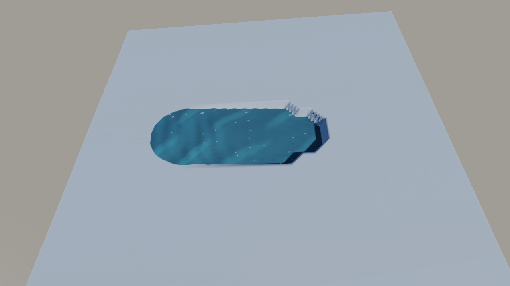
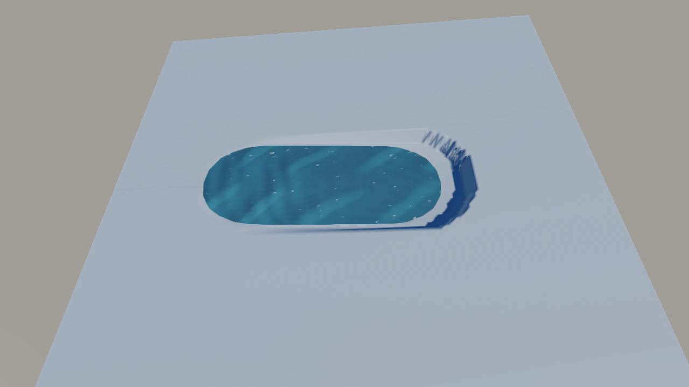
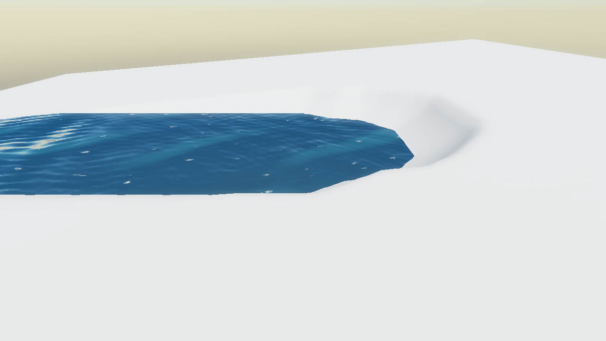
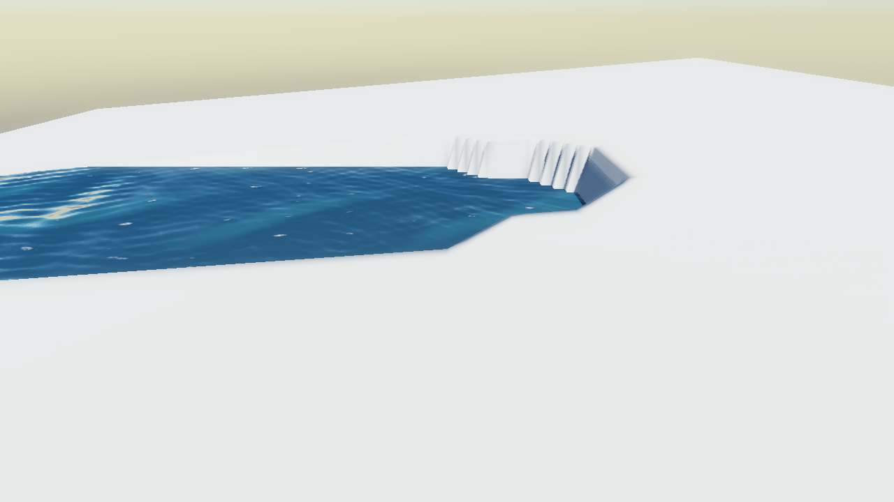
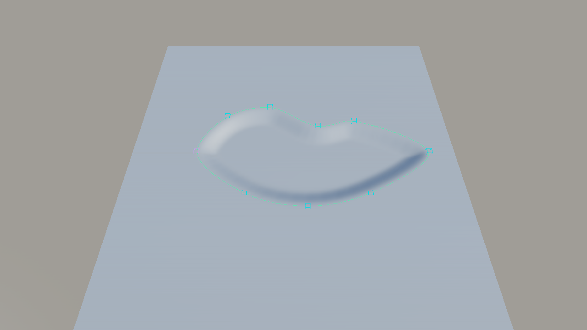
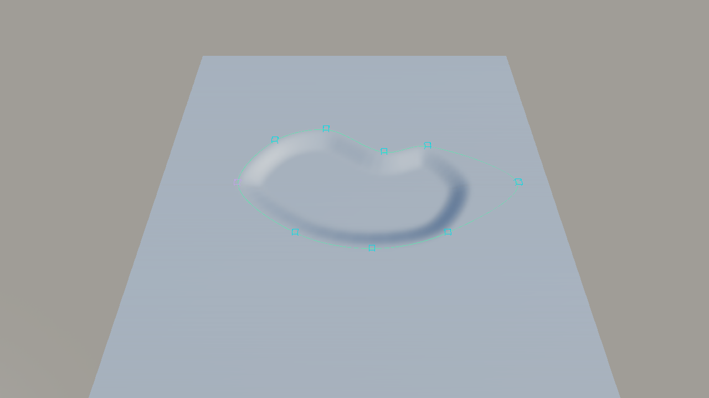

# Thema 188 Schritt 3: Abnahme Wasser-Pinsel-Grube und mitgehendes Seebett (13.10.2026)

Geprüft auf NN-WS03 (RTX 4070, laut `nvidia-smi` rendert jeder Lauf dort), Debug-Build des Zweigs
`claude/wasser-pinsel-lake-grube-fix` (Stand 6fa1a087 + Zeugen 2d894979), privater Deploy `C:/hw188/deploy`,
frisches `APPDATA` je Aufnahme. D3D12 mit Debug-Layer + DRED, Vulkan mit Validation-Layer (`HE_GPU_DEBUG=1`);
D3D11 hat keinen Debug-Layer, dort zählt nur Bild und Logzeile.

## Ergebnis

| Prüfung | D3D11 | D3D12 | Vulkan |
|---|---|---|---|
| Pinsel: keine trockene Grube, Grube ⊂ Fläche (`HE_DUMP_WATERBRUSH=pit`)¹ | ✔ | ✔ | ✔ |
| See: Bett folgt Lappen/Bucht (`HE_DUMP_LAKEEDIT=reshaped`) | ✔ | ✔ | ✔ |
| See: Bett folgt Frame für Frame (`=drag`) | ✔ | ✔ | ✔ |
| See: hin und zurück bit-genau (`=dragback`) | ✔ | ✔ | ✔ |
| See: Play-Modus, Collider, Stop (`=play`) | ✔ | ✔ | ✔ |
| `[ERROR]`-Zeilen im Log | 0 | 0 | 0 |

¹ „Exakt deckungsgleich“ ist das nicht, und zwei Abweichungen bleiben zur Entscheidung des Menschen (siehe unten):
- Die Fläche ist bergab bis ~2 m größer als die Grube, weil der Boden dort von Natur aus unter dem Pegel liegt.
- Bergauf steht über dem Wasser eine bis 4 m hohe, am Nordrand gezackte Böschung. **Seit Schritt 4 (14.10.)
  behoben:** Dort ist jetzt eine flache Böschung, siehe [Schritt 4](#schritt-4-böschung-statt-wand-14102026).

Die Logzahlen sind auf allen drei Backends identisch (die Geometrie entsteht auf der CPU). Die Bilder weichen von
Vulkan im Mittel um 1,0/255 (mit animiertem Wasser) bzw. 0,4/255 (Boden allein) ab.

Vollständige Testsuite (Debug, `he_tests.exe`, eigenes `APPDATA`): **5101 bestanden, 0 fehlgeschlagen**,
1 300 030 Assertions, 23 min. Ausgeschlossen, wie in den früheren Schritten: die drei Gamepad-Fälle
„End-to-end: …“ (echter Xbox-Controller am Rechner) und „PhysicsWorld: a full contact cache…“ (Jolt-Debug-Assert,
auch auf der Basis). CI 38311805813 auf 6fa1a087: grün auf Windows, Linux, Linux·Vulkan (lavapipe) und macOS.

## Wasser-Pinsel: Grube gegen Fläche

`HE_DUMP_WATERBRUSH=pit` stellt den Fall nach, in dem der trockene Krater auftrat: Gelände mit 8 % Steigung nach
Osten, das Pacing des Editors (Stärke 5 · 1/60 s, ein Dab je halben Meter, 97 Dabs), der Standardpinsel (Radius 10,
Falloff 5) und Dig Bed an. Das Landscape hat 128 m bei 129 Vertices und 32 Wasserzellen, also die Proportionen des
Editors. Gezählt wird gegen das Mesh, das `buildSurface` baut (das, was `WaterSurface` zeichnet), nicht gegen
`insideSheet`, denn sonst prüfte das Gate sich selbst.

| | abgesenkte Vertices | davon trocken | tiefste trockene Stelle | Grube x / z | Fläche x / z |
|---|---|---|---|---|---|
| Fix | 1337 | **0** | – | −36…24 / ±12 | −38,06…24,34 / ±12,43 |
| Negativkontrolle (Gate aus) | 1887 | **450** | 4,68 m | −38…32 / ±14 | −38,06…26,09 / ±12,53 |

Die Grube liegt jetzt ganz unter dem Wasser, die Fläche reicht aber über sie hinaus (40 Vertices unter Wasser,
nicht gegraben):
- **Bergab (West):** bis ~2 m. Dort liegt der Boden ohnehin unter dem Pegel; am Westende der Fläche (−38,06; 0)
  liegt er bei −3,04 m, der Pegel bei −2,10 m, also 0,94 m natürliche Wassertiefe ohne Aushub.
- **Seitlich und bergauf:** 0,3 bis 0,4 m, die Uferlinie zwischen den Vertices.

**Bleibt sichtbar, zur Entscheidung des Menschen:** Es ist das Erste, was man im Editor sieht, und eine Zählung
trockener Vertices erfasst es nicht. Bergauf schneidet der Pinsel bis auf den
Wasserspiegel, und darüber steht eine senkrechte Böschung von bis zu 4 m (Gelände über dem Pegel, das abgetragen
wurde). Am Nordrand ist sie gezackt, weil das Vertexgitter (1 m) gegen die Uferlinie der 4-m-Wasserzellen läuft.
Trockener Grubenboden ist dort nicht zu sehen. Mit `HE_DUMP_WATERHIDESHEET=1` sieht man den Boden allein; auf dem
Bild ist dann nur die Wand zu sehen. *(Stand 13.10. Seit Schritt 4 steht dort eine flache Böschung, siehe unten.)*

## Schritt 4: Böschung statt Wand (14.10.2026)

Geprüft auf dem MacBook Air (Metal, Release-Build des Zweigs, Stand a35abc85 plus Distanzfeld, siehe unten). NN-WS03 war offline, deshalb
**D3D11, D3D12 und Vulkan sind für diesen Schritt noch nicht geprüft.** Die Geometrie entsteht auf der CPU; die
Logzahlen waren in Schritt 3 auf allen drei Backends identisch, das ersetzt die Abnahme auf Hardware aber nicht.

`WaterBrush::shapeBank` senkt nach dem Graben das Gelände außerhalb der Fläche, das höher steht als
`foot + 0,5 · d / (1 − d / reach)`, auf diese Höhe:
- `d` ist der Abstand zur Uferlinie selbst (`water::shoreSegments`, dieselbe Zellregel wie `insideSheet` und das
  Mesh), nicht zum nächsten Vertex unter Wasser. Die 1-m-Treppe gegen die 4-m-Wasserzellen verschwindet so.
- `foot` liegt bei Pegel + Overshoot des Ufer-Clips + 1 cm. Die Böschung sinkt nie unter die Reichweite des
  Wassers: Sie ist trockenes Ufer, keine Grube, und die Fläche breitet sich nicht auf sie aus.
- `reach` ist Radius + Falloff des Pinsels. Dort wird das Profil senkrecht, deshalb gibt es keinen Absatz zum
  alten Gelände, und dahinter bewegt sich nichts.
- Die Zielhöhe hängt nur vom Ufer ab. Ein gehaltener Dab gräbt die Böschung nicht tiefer (Test).
- Wo die Uferlinie vom Ufer-Clip kommt, wandert sie nach außen, wenn die Böschung den Eckpunkt absenkt. Deshalb
  wird die Böschung bis zu 3-mal neu geformt (vorzeitig fertig, wenn sich nichts mehr um mehr als 1 mm bewegt).
  Mit nur einem Durchlauf stand der erste Vertex neben dem Wasser 0,83 m hoch statt 0,56 m. Mit 8 Durchläufen
  waren die Uferwände in allen Testfällen gleich wie mit 3, bei fast dreifacher Zeit.
- Den Abstand zum Ufer liefert ein Feld der nächsten Segmente: exakt neben jedem Segment, dann in zwei Durchgängen
  über die 8 Nachbarn weitergereicht. Die erste Fassung suchte je Vertex in den Zellen ringsum und brauchte auf
  einem feinen Gitter 798 ms je Dab.

`HE_DUMP_WATERBRUSH=pit`, gleiche Szene wie oben, Metal:

| | gegrabene Vertices | davon trocken (Grube) | Böschung | Uferwand höchstens | steilste Stufe je 1 m |
|---|---|---|---|---|---|
| Fix | 1759 | **0** | 408 (tiefster 0,07 m über Pegel) | **0,58 m** | 1,12 m |
| Negativkontrolle (Böschung aus) | 1337 | **0** | 0 | **4,10 m** | – |

„Uferwand“ heißt: Wie hoch steht der erste Vertex neben dem Wasser über dem Pegel. Die 0,58 m sind das Profil
selbst, denn ein Vertex liegt bis zu 1 m neben der Uferlinie. Die Negativkontrolle gibt die Zahlen aus Schritt 3
wieder (1337 Vertices). Das Bild der Fix-Version ist über zwei Läufe bitgleich, und 0 `[ERROR]` im Log.

Kamera der Nahaufnahme: `HE_DUMP_CAMX=12 HE_DUMP_CAMY=312 HE_DUMP_CAMZ=34 HE_DUMP_PITCH=-28` (dazu
`HE_SKY_TIME=30 HE_DUMP_TOD=0.45 HE_DUMP_COVERAGE=0 HE_DUMP_CLOUDMODE=0 HE_DUMP_RENDERPATH=0 HE_DUMP_AA=0`).
Negativkontrolle, nie committen: in `WaterBrush.cpp` (`dab`) `shapeBank(...)` durch `0u` ersetzen.

Tests (`test_water_brush.cpp`): In allen Pinsel-Fällen bergauf ist die Uferwand 0,55 bis 0,58 m (vorher bis 4 m),
die steilste Stufe 0,84 bis 1,2 m je Meter, und es bleiben 0 trockene Grubenvertices. Flaches Gelände unter dem
Pegel bekommt keine Böschung. Neu ist der Test für einen gehaltenen Dab: Nach dem 10. Dab bewegt sich neben dem
Wasser nichts mehr. Die volle Suite `he_tests` (Release, macOS) lief auf a35abc85 grün: 5098 Fälle, 0 Fehler. Nach
dem Umbau auf das Distanzfeld liefen 568 Wasser-, Terrain-, See-, Sculpt- und Hilfe-Fälle erneut grün.

**Kosten je Dab** (Release, M-Mac unter Fremdlast, Pinsel-Pacing des Editors, 97 Dabs bergauf, Mittel / schlimmster):

| Raster | mit Böschung | ohne Böschung (Negativkontrolle) |
|---|---|---|
| Editor-Standard: 1 km, 1025², 256 Wasserzellen | 1,2 ms / 2,0 ms | 0,28 ms / 0,36 ms |
| 128 m, 129², 32 Wasserzellen (Zeugen-Rig) | 0,8 ms / 1,9 ms | 0,23 ms / 0,28 ms |
| 128 m, 1025², 256 Wasserzellen (12,5 cm je Vertex, Stresstest) | 48 ms / 72 ms | 6,6 ms / 8,0 ms |

Im Stresstest kostet die Böschung also eine sichtbare Ruckelzeit je Frame, solange gemalt wird. Gemessen mit
einem nicht committeten Zeitmess-Testfall. Debug und Windows sind nicht gemessen.

## Lake-Werkzeug: Das Bett geht mit

- **`=reshaped`:** Boden unter dem herausgezogenen Lappen (27, −12) geht von 0,00 auf −2,44 m, in der
  hineingedrückten Bucht (4, 16) von −0,65 auf 0,00 m. Mit der Negativkontrolle (`follow` → `reshape`) bleiben beide
  Werte unverändert: 0,00 → 0,00 und −0,65 → −0,65.
- **`=drag`:** Die Ostspitze wird in 12 Frames je 1 m von (30,0) auf (42,0) gezogen, mit einem `updateTerrains` je
  Frame wie im Editor. Der Boden bei (36,0) folgt in jedem Frame (0,00 … −0,18 / −0,63 / −1,17 / −1,62 / −2,01 /
  −2,25 m), die Chunks sind am Ende jedes Frames neu gebaut. Mit der Negativkontrolle bleiben alle 12 Frames bei
  0,00, und kein Vertex ändert sich.
- **`=dragback`:** Hin und zurück (24 Frames) ergibt **0 abweichende Vertices**, auch auf 1025².
- **`=play`:** `setPlayMode(true)`, Spitze auf (40,0), dann `SceneSystems::tickWorld` mit der Physikwelt.
  - Boden 0,00 → −1,62 m im selben Frame.
  - Der Collider (Raycast) steht im Zieh-Frame noch auf 0,00 und einen Frame später auf −1,62. Das ist gewollt:
    Er wird nachgezogen, sobald das Terrain einen Frame ruht (`TerrainSystem.cpp`).
  - Nach Stop (Snapshot-Restore) ist der Boden wieder 0,00, der See gräbt weiter, und der Patch ist erhalten.
  - Dasselbe Ziehen im Editmodus gräbt danach wieder (−1,62 m).
  - Mit der Negativkontrolle bleiben Boden und Collider bei 0,00.

**Kosten je Zieh-Frame** (Debug, `updateTerrains` gesamt, also Sync, Neu-Graben, Chunk-Neubau und Wasserfläche):

| Raster | Frame | ohne Neu-Graben (Negativkontrolle) |
|---|---|---|
| **Editor-Standard: 1 km, 1025², 256 Wasserzellen** (1628 gegrabene Vertices) | **6,7 ms** Mittel, 7,15 ms schlimmster | – |
| 129² auf 100 m, 128 Wasserzellen (1 m/Vertex) | 8,7 ms Mittel, 12,6 ms schlimmster | 2,7 ms |
| 1025² auf 100 m (10 cm/Vertex, 164 000 gegrabene Vertices) | 124 ms Mittel, 137 ms schlimmster | – |

Die erste Zeile ist mit `HE_DUMP_LAKESIZE=1000 HE_DUMP_LAKERES=1025 HE_DUMP_LAKEWATERRES=256` gemessen, auf Vulkan
und D3D12 gleich. Hin und zurück ist auch dort bit-genau. Die letzte Zeile ist ein Stresstest mit 64-facher
Vertexdichte. Release ist nicht gemessen.

## Nicht geprüft / offen

- Kein echtes Ziehen mit der Maus im Editorfenster. Der Mensch sitzt an der Konsole; die Zeugen rufen dieselben
  Funktionen in derselben Reihenfolge wie der Frame des Editors (`SceneSystems::tickWorld` ruft
  `updateTerrains` in jedem Frame, im Edit- wie im Play-Modus, `EditorApplication.cpp`).
- Das In-Editor-Handbuch (`he-docs.json`, Website-Repo) beschreibt das Ziehen noch als „only reshapes the water“.
- Grenzen aus Schritt 2 gelten weiter:
  - Ein Auflösungswechsel verwirft den Patch, und das alte Bett bleibt als Loch.
  - Überlappende Seen addieren ihre Patches.

Zum Nachstellen: `HE_DUMP_WATERBRUSH=pit` bzw. `HE_DUMP_LAKEEDIT=drag|dragback|play` mit `HE_DUMP_SKYTEST=1
HE_DUMP_CAMY=375 HE_DUMP_CAMZ=48 HE_DUMP_PITCH=-60`, optional `HE_DUMP_WATERHIDESHEET=1` (Boden allein) und
`HE_DUMP_LAKERES` / `HE_DUMP_LAKESIZE` / `HE_DUMP_LAKEWATERRES`.

Negativkontrolle, nie committen: in `WaterBrush.cpp` (`keepUnderSheet`) die Zeile
`if (sheet && insideSheet(...)) continue;` durch `continue;` ersetzen, in `WaterLake.cpp` (`syncSplines`)
`follow(tc, b.id, poly)` durch `reshape(tc, b.id, poly)`.
